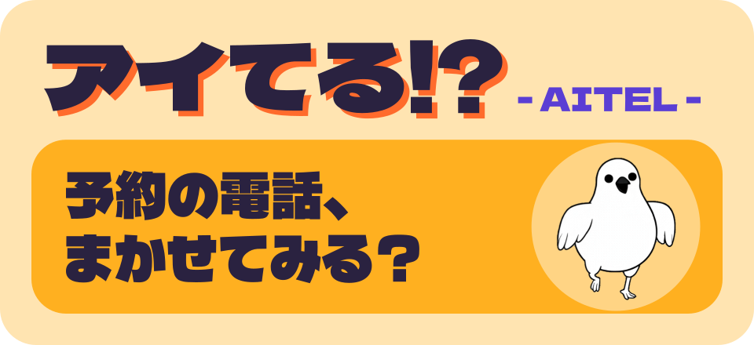
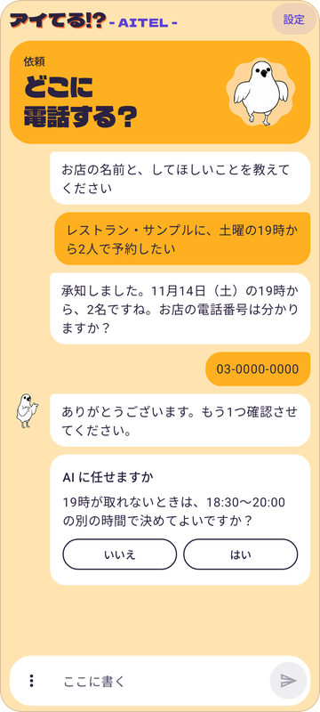
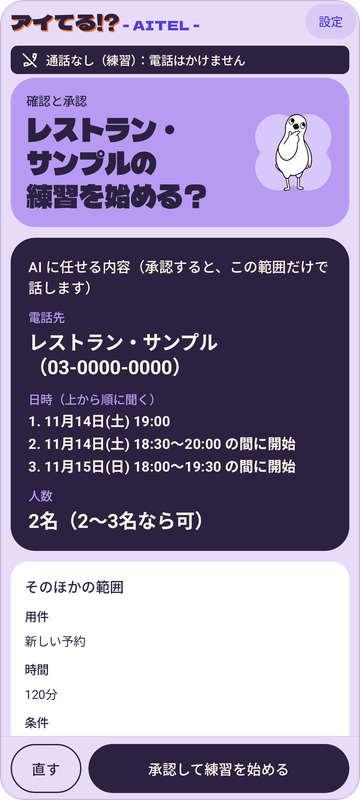
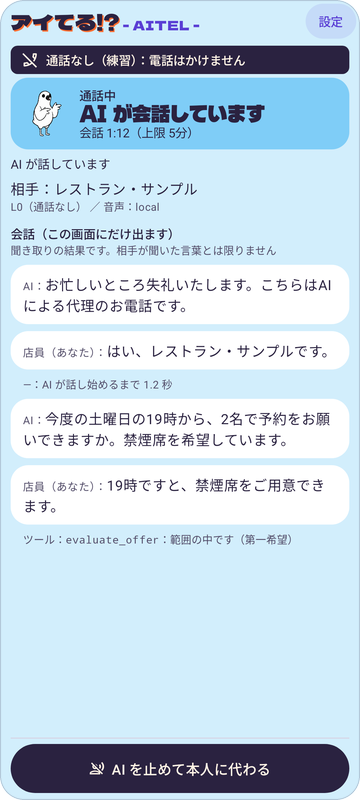
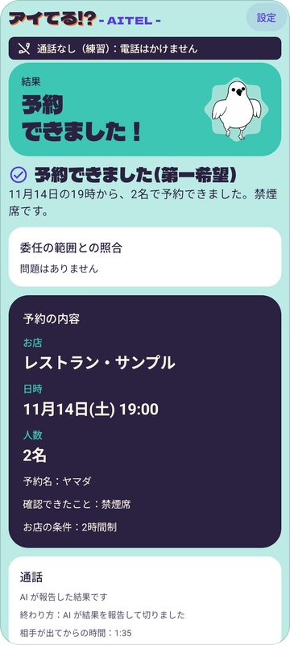
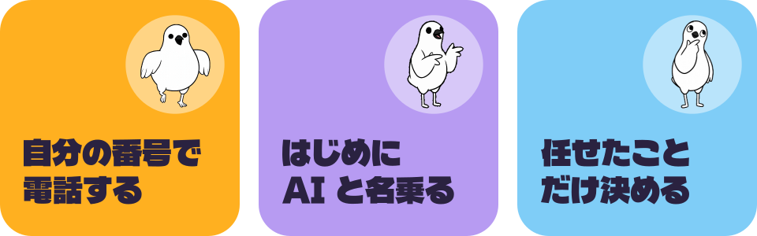
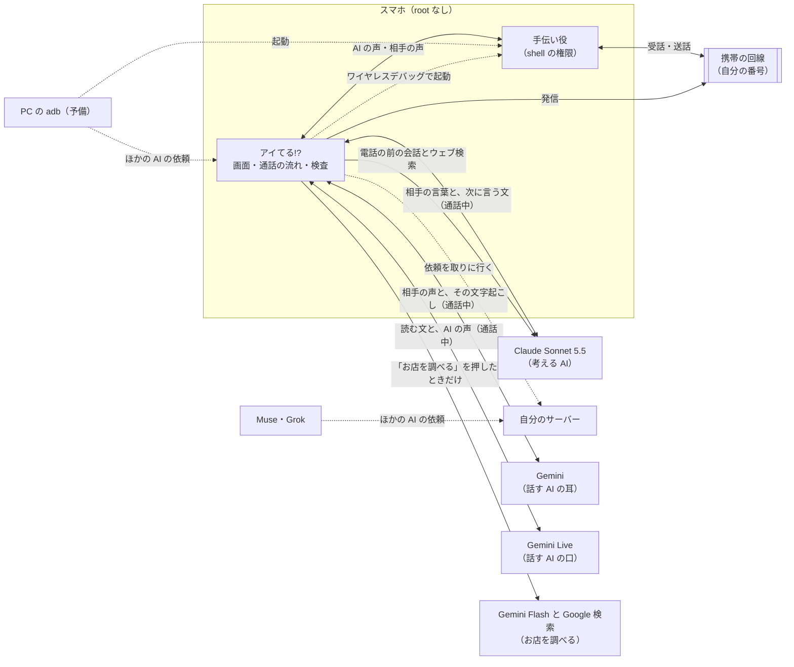

<p align="center">
  
</p>

<p align="center"><b>アイてる!? - AITEL -</b><br>電話予約が必要なときに、AI がかわりに電話するアプリです。</p>

> [!NOTE]
> **審査の方へ**
>
> - **どんなアプリか**：電話でしか予約できないお店に、自分のスマホと自分の番号から AI が電話して、AI だと名乗ってから、本人が承認した範囲で話をする Android アプリです
> - **APK**：[Releases（v0.9.0）](https://github.com/Devfest-Hackathon-2026/df-2026-t130/releases/tag/v0.9.0)
> - **動かす**：電話をかけない練習までは、[いちばん短い道](#いちばん短い道apk-を入れて練習まで) のとおりです。PC は要りません
> - **デモ動画と説明の資料**：提出フォルダにあります
> - **本物の電話**：Android 14 以上のスマホと、手伝い役（通話の音を扱う小さなプログラム）の起動が要ります。確かめた端末は Nothing Phone (2a) の 1 台だけです
> - **Grok・Muse との連携**：作者のサーバー（URL は非公開）で確かめました。Muse は、依頼、スマホでの承認、実際の電話（AI の受付の公開デモ）、AI が結果を読むところまで通りました。Grok は、依頼がスマホに届いて、断ると AI に返るところまでです。自分で試すには、サーバーを立てる必要があります（[docs/mcp-setup.md](docs/mcp-setup.md)）

<p align="center">
  
  
  
  
  <a href="LICENSE"></a>
</p>

<h3 align="center">予約の電話、ぜんぶ AI に任せたい！</h3>

<p align="center">
お店と日時を入れて、任せる範囲を決めて、承認するだけ。<br>
あとはアイてる!? が自分のスマホから、自分の番号でお店に電話して、AI だと名乗ってから話します。
</p>

<p align="center">
  <a href="#news">最近の更新</a>
  &nbsp;·&nbsp;
  <a href="#what">できること</a>
  &nbsp;·&nbsp;
  <a href="#status">いまの状態</a>
  &nbsp;·&nbsp;
  <a href="#how">しくみ</a>
  &nbsp;·&nbsp;
  <a href="#try">ためしかた</a>
  &nbsp;·&nbsp;
  <a href="#safety">安全のこと</a>
  &nbsp;·&nbsp;
  <a href="docs/install.md">入れ方</a>
  &nbsp;·&nbsp;
  <a href="docs/safety.md">使う前に読むこと</a>
  &nbsp;·&nbsp;
  <a href="docs/privacy.md">プライバシー</a>
  &nbsp;·&nbsp;
  <a href="apps/rotep/README.md">アプリのくわしい説明</a>
</p>

<p align="center">
  
  
  
  
</p>

<p align="center"><sub>会話 → 確認 → 通話中 → 結果。写っているのは、練習用の架空のお店で作った見本の画面です。本物の電話の画面ではありません</sub></p>

> [!NOTE]
> この README では、できあがっている部分と、実際に確かめた範囲を紹介します。いまの既定の形（声は Gemini、考えるのは Claude の二重モデル）では、IVRy の公開デモ（AI の受付）への実際の電話で、予約成立まで通りました（2026-11-10）。協力者（試験に協力してくれた人）との二重モデルの電話は、まだです。協力者との電話で通したのは、Gemini だけで話す形です（2026-11-09）。サーバーを通した依頼は、Muse から頼んで、スマホで承認して、IVRy の公開デモに電話し、Muse が結果を読むところまで通りました（2026-11-10）。Grok は、依頼がスマホに届いて断るところまでです。PC なしで準備する形も、スマホで起動まで通りました。確かめた範囲は [いま、どこまで？](#status) にまとめています。

<br><br>

<a name="news"></a>


-  **2026-11-10** Muse と Grok から、Cloud Run に置いたサーバーを通して、スマホに依頼が届きました。スマホで断ると、AI に `declined` が返ります（電話はかかりません）。Muse の依頼では、スマホで承認して IVRy の公開デモに電話し、AI が結果を読むところまで通りました。Grok から実際に電話して結果を読むところは、まだです
-  **2026-11-10** 通話の考える役を Claude にしました。声は Gemini Live のままです（二重モデル）。Claude のキーが電話にも要るようになり、相手の言葉の文字起こしと依頼の内容（予約名、連絡先の番号など）は Anthropic にも送られます。設定で Gemini だけの形に戻せます。IVRy の公開デモ（AI の受付）への実際の電話で、予約成立まで通りました。協力者との二重モデルの電話は、まだです
-  **2026-11-10** 銀行のアプリのために、開発者向けオプションを普段は切っておける設定を足しました（任意。エミュレータでだけ通しています。スマホでの確認はこれからです）
-  **2026-11-09** 電話の記録、結果の画面から続けて頼むボタン、通話中の固定のボタン、お店からの折り返しの通知を足しました（スマホでの確認はこれからです）
-  **2026-11-09** 協力者との電話で、「全自動で電話をかける」が、発信から電話を切るところまで通りました。相手が出たら、何も押さなくても AI が話し始めます。同じ電話で読み間違いなどの問題も見つかったので、直しを入れました
-  **2026-11-09** [入れ方](docs/install.md)、[使う前に読むこと](docs/safety.md)、[配り方](docs/distribution.md)の文書を足しました
-  **2026-11-09** Muse や Grok などのクラウドの AI から、自分で立てたサーバーを通して電話を頼めるようにしました。電話がかかるのは、スマホで本人が承認したときだけです
-  **2026-11-09** PC がなくても、スマホのワイヤレスデバッグで手伝い役（通話の音を扱う小さなプログラム）を起動できるようにしました（ペアリングと起動は、スマホでも通りました）
-  **2026-11-09** 設定の「電話のしかた」を、「練習」「電話をかける」「全自動で電話をかける」の3つにしました（スマホで確かめたのは「全自動で電話をかける」だけです）
-  **2026-11-09** 相手が出たら AI が自動で話し始めるようにして、通話の操作を AITEL の画面に集めました。指定した時刻の電話、Google カレンダーへの追加、電話の前にお店に聞かれそうなことを聞く会話も足しました（スマホで確かめたのは、「全自動で電話をかける」で相手が出たら話し始めるところだけです）
-  **2026-11-09** 協力者との電話で、AI の声が相手に届いて、結果の報告まで通りました。このときは、相手が出たことを手で知らせていました
-  **2026-11-09** 最初の画面を、AI との会話にしました。頼みたいことを書くと、足りないことを AI が聞いて、お店も調べます。フォームで入れたいときは「手で入力する」を選びます
-  **2026-11-09** 画面の顔、アプリのアイコン、起動の画面を、動く鳥に替えました。うまくいかなかったときは謝る鳥、発信中は歩く鳥が出ます
-  **2026-11-08** アプリを見ていないときに通話が終わると、通知で知らせます。急ぎのことが残ったときは、振動つきの別の知らせになります
-  **2026-11-08** 実際に発信した電話の結果を、最後の1件だけスマホに残します
-  **2026-11-08** パソコンの AI から USB（adb）で、電話の依頼を渡せるようになりました（MCP）。電話がかかるのは、スマホで本人が承認したときだけです
-  **2026-11-08** 確認の画面で、電話の前にお店を調べられるようになりました
-  **2026-11-08** 予約の取り消しを任せられるようになりました。キャンセル料の扱いも、任せた範囲で決まります
-  **2026-11-08** AI が電話している間は、スマホから通話の音を出さなくなりました（既定）
-  **2026-11-08** 画面ごとの色、文字の強弱、動きを作り直しました

<br><br>

<a name="what"></a>


<p align="center">
  
</p>

予約をまだ電話でしか受けていないお店、けっこうありますよね。営業時間に電話して、つながるのを待って、空いている時間を聞いて……というあれを、AI にかわってもらうためのアプリです。

| 流れ | すること |
| :-- | :-- |
| 1. **依頼** | 最初の画面で、頼みたいことを書きます。足りないことは AI が聞きます。任せる範囲は「はい／いいえ」のボタンで答えます。お店のことは、会話の中で AI が調べて見せます。入力欄の ⋮ の「手で入力する」で、フォームから入れることもできます |
| 2. **確認** | AI に任せる中身をひとつの画面で見直して、承認します。入れ忘れや、つじつまの合わない依頼は、ここでアプリが止めます |
| 3. **通話** | アイてる!? が電話をかけて、名乗ってから話します。会話はその場で文字になって、通話の画面にだけ出ます |
| 4. **結果** | 予約できたのか、別の時間で決まったのか、折り返しになったのか。任せた範囲から外れていないかも、アプリが照らし合わせて見せます |

頼める用件は「新しい予約」「予約の変更」「予約の取り消し」「問い合わせ」の4つです。

上のカードの3つは、どの電話のしかたでも変えない約束です。

- **自分の番号で電話する**：お店からの折り返しや確認の電話が、ちゃんと自分に届くように。日本だと、Twilio のような通話サービスから自分の番号を出してかけることができないので、スマホそのものからかけます
- **はじめに AI と名乗る**：出た人には、最初に「こちらはAIによる代理のお電話です」と伝えます。人のふりはしません
- **任せたことだけ決める**：日時や人数の幅、伝えていいことは、電話の前に自分で決めておきます。その外のことを聞かれたら、AI は決めずに「その点は確認して、改めてこちらから折り返しご連絡いたします。」と伝えて電話を終えます

ほかに、こんなふうに作っています。

- **取り消しの電話も任せられる**：予約名と、取り消す予約の日時などを入れます。キャンセル料がかかると言われたら、「キャンセル料がかかっても取り消してよい」をオンにしていない限り、取り消さずに本人に返します
- **静かに任せられる**：AI が電話している間は、スマホから通話の音を出しません（既定）。AI があなたに代わるときと、通話が終わったときに音が戻ります。聞いていたいときは、設定の「通話の音をこの端末で鳴らす」をオンにします
- **電話の前にお店を調べられる**：会話で店名（予約や変更なら希望の日時も）が分かると、Claude のウェブ検索で、営業時間や予約の受け方、希望の時間に行けそうかを調べて、出典つきで見せます。電話番号は検索に使いません。会話で調べた結果がないときは、確認の画面の「お店を調べる」を押すと、Gemini の Google 検索で調べます。こちらは押したときだけ動きます。合わない日時は、電話の前に直せます。取り消しの電話と練習の例では出ません
- **ほかの AI から頼める**：Muse や Grok などのクラウドの AI からは、自分で立てたサーバーを通して、パソコンの AI からは USB（adb）で、電話の依頼を渡せます（MCP）。依頼が届いても電話はかかりません。スマホで中身を見て、本人が承認したときだけかかります。サーバーの立て方から Muse・Grok の登録までは [docs/mcp-setup.md](docs/mcp-setup.md) に上から順に書いてあります。パソコンの AI からのつなぎ方は [apps/rotep/mcp/README.md](apps/rotep/mcp/README.md) にあります
- **前回の結果が残る**：実際に発信した電話の結果を、最後の1件だけスマホに残します。「最初に戻る」のあとでも、アプリを閉じたあとでも、予約の内容を読み直せます。次の電話で入れ替わって、結果の画面で消せます。練習の結果は残しません。これとは別に「電話の記録」が既定でオンになっていて、文字起こしも含めて、暗号化して 90 日・50 件まで残します（設定で切れます）
- **結果から続けて頼める**：結果の画面に、予約が取れたら「変更」「取り消し」、取れなかったら「続き」のボタンが出ます。押すと依頼のフォームが埋まるだけで、電話はかかりません（確認の画面の承認は毎回です）。「前回の電話」から開いたときは、その電話が電話の記録に残っていれば番号も入り、なければ入れ直します
- **通話中に決まった文を頼める**：「少し待ってもらう」「断って終える」のボタンで、決まった文を AI に伝えられます。自由な文の指示はできません
- **お店からの折り返しが分かる**（既定はオフ）：電話の記録に残っている電話のお店から着信があると、どのお店の件かを通知で知らせます。着信は止めません。通知は音なしで、ロック中は出ません。オンにするには、このアプリを端末の「発信者番号と迷惑電話」のアプリに選びます（端末で 1 つのアプリだけです）。連絡先にある番号と、番号を通知しない着信は対象外です

> [!NOTE]
> ここに書いたものは、どれもコードには入っています。スマホで確かめたのは「ほかの AI から頼める」のうち、Muse と Grok からサーバーを通す形だけで（[いま、どこまで？](#status)）、ほかは、まだ確かめていません。

電話はかけずに、自分が店員さんの役をして AI と練習することもできます（設定の「練習」です）。最初はここから試すのがおすすめです。

<sub>ちなみに名前は、AI ＋ TEL で AITEL。日本語で読むと「アイてる!?」、つまり「予約、空いてる？」です。</sub>

<br><br>

<a name="status"></a>


目指しているのは、電話をかけてから切るまでアプリが行う「全自動で電話をかける」です。どこまで確かめたかは、次の表のとおりです。

| 電話のしかた | どんな形 | いま（2026-11-10） |
| :-- | :-- | :-- |
| 練習 | 電話はかけない。スマホのマイクとスピーカーを使って、自分が店員さんの役をする | アプリに入っています。手で入力した依頼で、電話をかけずに結果の報告まで通せました（2026-11-08）。二重モデルの練習も、スマホで通しました（2026-11-10）。最初の画面の会話から通すのは、まだ確かめていません |
| 電話をかける | アプリが電話をかけて、手伝い役（通話の音を扱う小さなプログラム）が AI の声を通話に流す。相手が出たことも手伝い役が読み取る | 協力者との通話で、AI の声が相手に届いて、結果の報告まで通りました（2026-11-09）。このときは「相手が出た」を手で押しました。読み取りの自動化と、通話の画面からの操作は、まだ確かめていません |
| 全自動で電話をかける（目標） | 「電話をかける」と同じ音の通り道で、電話をかけてから切るまで、ぜんぶアプリが行う | アプリに入っています。設定で「全自動で電話をかける」を選んで、許可（設定の「診断の画面を開く」から入る画面の「全自動を許可」か、PC の adb）を入れたときだけ動きます。協力者との電話で、発信、相手が出たことの読み取り（何も押さない）、AI の名乗り、予約の報告、最後の挨拶のあとアプリから切るまで通りました（2026-11-09 21:51）。同じ電話で見つかった問題は下の表のとおりで、直しを入れました。設定の最初の形は「練習」です |

スマホでの確認は、いまこうなっています（順番は上から）。

| 確かめること | 結果 |
| :-- | :-- |
| 通話なしで AI と話して、結果の報告まで進むか | ✅ 合格 |
| shell の権限に、通話の音を扱う権限があるか | ✅ 合格 |
| 相手の声を取れるか | 協力者との通話で確かめました（2026-11-09） |
| 手伝い役が PC から起動して、相手の声の音量を取れるか | 協力者との通話で確かめました（2026-11-09） |
| 通話に流した音が相手に届くか | AI の声が届きました（2026-11-09）。目印の音の試験そのものは行っていません |
| AI が相手と話して、結果の報告まで通るか | 通りました（2026-11-09）。最初の発話で声が乱れたので直しを入れて、21:51 の電話では、最初の AI の声がはっきり聞こえました（協力者の話。送話の統計にも乱れはありません） |
| アプリが通話を操作できるか（全自動で電話をかける） | 通りました（2026-11-09 21:51）。発信、相手が出たことの読み取り（何も押さない）、AI が話し始める（相手が出てから約 2.5 秒）、AI の名乗り、予約の報告、最後の挨拶のあとアプリから切るまでです。スピーカーとキーパッドは、まだ確かめていません |
| 21:51 の電話で見つかった問題 | 直しを入れました。協力者との電話でもう一度確かめるのは、まだです。「お忙しいところ」「二名」の読み間違い。予約名が途中で切れても、言えたことにしていた。AI が提案の確認（`evaluate_offer`）を飛ばした |
| 二重モデルの通話（声は Gemini、考えるのは Claude）で、AI が相手と話して結果の報告まで通るか | IVRy の公開デモ（AI の受付）への実際の電話で、予約成立まで通りました（2026-11-10 08:51）。デモの受付との会話の中での予約で、本物のお店の予約ではありません。相手が先に切っても、失敗になりませんでした。協力者との二重モデルの電話は、まだです。この表のほかの AI の通話の結果は、どれも Gemini だけで話す形のものです（いまは設定の「通話の考える役に Claude を使う」を切ると、この形になります） |
| 手伝い役が、再起動のあとと Wi-Fi が切れたあとも動くか | どちらも動きました（2026-11-10）。USB デバッグも切ったときは、まだ確かめていません |
| 時間を指定した電話、カレンダーへの追加 | まだ確かめていません |
| 電話の記録、結果の画面から続けて頼むボタン、通話中の固定のボタン、お店からの折り返しの通知 | まだ確かめていません |
| 開発者向けオプションを普段は切っておく形：電話の間だけ、アプリが USB デバッグをオンにできるか | スマホでは、まだ確かめていません。エミュレータでだけ通しました |
| PC なしの起動：スマホのワイヤレスデバッグで手伝い役を起動できるか | ペアリングと手伝い役の起動は、スマホで通りました（2026-11-09 の夜）。手伝い役は、ワイヤレスデバッグがオフでも、USB デバッグがオンなら残っていました。USB デバッグも切ったときは、まだ確かめていません。PC からの起動は予備として残しています |
| サーバーを通した依頼：Muse・Grok から頼んで、スマホで承認して電話し、AI が結果を読めるか | Muse は、作者の提出用のサーバー（Cloud Run）を通して 1 回通りました（2026-11-10 13:20）。Muse の依頼をスマホで承認して、IVRy の公開デモ（AI の受付）に実際に電話し、AI が報告して切ったあと、Muse が `get_call_request` で `finished` と結果を読みました。電話の結果は `NEEDS_USER_DECISION`（本人が決めることが残った）で、予約成立まではいっていません。このとき、声のモデルの返事が来ずに最大 30 秒止まる不具合が 1 回出ました。Grok は、依頼がスマホに届いて、断ると `declined` が返るところまでです（電話なし）。Grok から実際に電話して結果を読むところは、まだ確かめていません |
| どの AI からの依頼かが分かるか、もう一方の AI に依頼の中身が渡らないか | スマホの帯に Grok と Muse の名前が出ました。一方の AI の依頼が残っている間、もう一方の AI には「スマホで別の依頼を処理しています」という文だけが返りました（電話なし。2026-11-10） |

- 確かめる端末は Nothing Phone (2a)（Android 16）の1台だけです。ほかの端末で動くかは、まだ分かりません。このアプリの土台は、もともと root のスマホに入れる形で設計しました。root なしの形を正式な方式に加えるかは、まだ決めていません（[ADR-028](docs/decisions.md)）

<br><br>

<a name="how"></a>


### 話す AI と、考える AI

アイてる!? は、役割のちがう2種類の AI で作っています。話す AI（Gemini）の仕事は、通話中に相手の声を聞き取ることと、渡された文を遅れずに声にすることです。考える AI（Claude）の仕事は、電話の前に依頼を整理することと、通話中に次に何を言うかをすべて決めることです（二重モデル。[ADR-053](docs/decisions.md)）。設定の「通話の考える役に Claude を使う」を切ると、通話は Gemini Live だけで行います。

| 役割 | モデル | いつ動くか | 仕事 | いま |
| :-- | :-- | :-- | :-- | :-- |
| **話す AI（口）** | Gemini Live（`gemini-3.8-live`） | 通話中 | 渡された文をそのまま声にする。名乗り、相づち（「はい。」）、つなぎ（「少々お待ちください。」）は決まった文を読む | Gemini だけで話す形は、協力者との電話で声が届きました（2026-11-09）。渡された文を読む形は、IVRy の公開デモへの電話で通りました（2026-11-10） |
| **話す AI（耳）** | `gemini-3.5-transcribe-live` | 通話中 | 相手の声を文字にするだけ | IVRy の公開デモへの電話で通りました（2026-11-10） |
| **お店を調べる** | 会話の中は Claude のウェブ検索。確認の画面の「お店を調べる」は `gemini-3.8-flash` と Google 検索 | 電話の前。会話で店名（予約や変更なら希望の日時も）が分かったとき（電話番号は送りません）。「お店を調べる」は、会話で調べた結果がないときに出て、押したときだけ動きます | 営業時間や予約の受け方、希望の時間に行けそうかを調べる | アプリに入っています |
| **考える AI** | Claude Sonnet 5.5（`claude-sonnet-5-5`） | 電話の前と通話中 | 電話の前：会話で依頼を聞いて、足りないことを聞き、条件を整理する。漢字の読みを用意する。通話中：相手の言葉から、次に言う文と使うツールをすべて決める | 通話中の役目は、IVRy の公開デモへの電話で通りました（2026-11-10）。電話の前の会話は、スマホでまだ確かめていません |

> [!NOTE]
> 考える AI が動くのは、最初の画面の会話と通話中です（コードは `apps/rotep` の `intake/` と `call/dual/` にあり、`agent-think/` は置き場だけです）。調べた結果は出典つきで本人に見せ、考える AI も読んで、希望の時間に合わないときはそう伝えます。カレンダーを見る、結果を整理する、お店ごとのことを覚えるのは、これからです。考える AI が作った依頼も、同じ検査を通し、本人が承認するまで電話はかけません。



もうひとつ大事にしているのが、AI に決めさせないことです。たとえばお店に「19時半なら空いてます」と言われたとき、それを受けていいかは AI ではなく、アプリのコードが依頼と照らし合わせて答えます（`evaluate_offer` というツール）。AI は、その答えに沿って話すだけです（2026-11-09 の電話では AI がこの確認を飛ばしたので、直しを入れました）。

### root なしで、通話の音を扱う

AI がふつうの電話で話すには、通話の音を取ったり流したりしないといけません。ところがその権限（`CAPTURE_AUDIO_OUTPUT` など）は、ふつうのアプリにはもらえないんです。root にすれば話は早いのですが、普段使いのスマホにはしたくない。

そこでアイてる!? は、**手伝い役**を起動します。手伝い役は `app_process` で動く、shell の権限の小さなプロセスです。起動すると、自分の窓口（Binder）をアプリの `HelperProvider` に渡します。アプリは通話の音の出し入れと、AI が電話している間の消音をこれに頼みます。「電話をかける」では、相手が出たことの読み取りと、電話を切ることも頼みます。

起動のしかたは 2 つあります。どちらも同じ手伝い役を起動します。

- **PC の adb から**：協力者との電話（2026-11-09）で動いた形です。USB を抜いても動き続ける作りです
- **スマホだけで（PC なし）**：アプリがスマホのワイヤレスデバッグ（自分の端末の adbd だけ）につないで起動します（[ADR-041](docs/decisions.md)）。ペアリングと起動は、スマホで通りました（2026-11-09 の夜）

止まるのは、診断の画面で「終了」を押したとき、アプリを入れ直したとき、アプリに10分つながらなかったとき、スマホを再起動したときで、そのときはもう一度起動します。USB デバッグとワイヤレスデバッグがどちらもオフになったときも止まるはずです（ソースから分かることで、スマホでは確かめていません。ワイヤレスデバッグがオフでも、USB デバッグがオンなら残ることは、スマホで確かめました）。PC なしの形でペアリングしてあれば、再起動のあと Wi-Fi につながったところで、アプリが自分で起動し直します（再起動のあとも動くことは、スマホで確かめました。2026-11-10）。アプリを更新したあとと、手伝い役が消えたときも、アプリが自分で起動し直します（こちらはエミュレータでだけ確かめました）。Wi-Fi につながったまま USB デバッグとワイヤレスデバッグの両方がオフのときは、自分で切ったとみなして、起動し直しません。

最初は Shizuku で起動するつもりでしたが、Shizuku 13.6.0 は Android 16 の Nothing Phone で手伝い役を起動できなかったので（2026-11-07）、adb から直接起動する形にしました。いまのアプリは Shizuku を使っていません。

「全自動で電話をかける」では、アプリが自分でかけた1本だけを、画面のない `InCallService` で操作します。これには、`MANAGE_ONGOING_CALLS` の AppOps の許可が要ります（PC の adb か、診断の画面の「全自動を許可」で入れます）。

全体の設計は [docs/design.md](docs/design.md)（2026-11-05 の版で、いまのアプリとは違うところがあります）、話す AI への渡し方は [docs/live-agent.md](docs/live-agent.md)、任せる範囲の形は [docs/delegation-policy.md](docs/delegation-policy.md)、ここまでの決めごとは [docs/decisions.md](docs/decisions.md) の ADR-027 以降にあります。

<details>
<summary>リポジトリの中身</summary>

<br>

アイてる!? のコードは `apps/rotep` にあります（rotep は開発のときの名前です）。パッケージ名や Gradle のプロジェクト名は `io.github.incallagent.rotep`・`:apps:rotep` です。

| 場所 | 中身 |
| :-- | :-- |
| `apps/rotep/` | アイてる!? の本体。画面、通話の流れ、手伝い役（`helper/` が起動のスクリプト）、ほかの AI から頼むための MCP サーバー（`mcp/`）と、自分で立てる窓口のサーバー（`server/`） |
| `core/` | 任せる範囲（委任ポリシー）の形と検査、結果の照らし合わせ、ログのマスク |
| `agent-live/` | Gemini Live への接続、指示文、ツール |
| `audio-bridge/` | スマホのマイクとスピーカー、通話の音を扱う部品 |
| `telecom/`、`agent-think/` | 通話の操作と、考える AI の置き場（まだほとんど空です） |
| `magisk-module/` | root の端末で確かめるために作ったもの（いまのアイてる!? では使っていません） |
| `docs/` | 設計、決めたこととその理由（ADR）、[入れ方](docs/install.md)、[使う前に読むこと](docs/safety.md)、[配り方](docs/distribution.md) |
| `tools/readme-art/` | この README の絵を作るスクリプト |

</details>

<br><br>

<a name="try"></a>


入れ方の全部は [docs/install.md](docs/install.md)、使う前に読んでほしいことは [docs/safety.md](docs/safety.md)、何がどこへ送られるかは [docs/privacy.md](docs/privacy.md) にあります。

### いちばん短い道（APK を入れて練習まで）

審査などで動きを見たいときは、ここから始めてください。PC は要りません。設定の「電話のしかた」は最初は「練習」なので、電話はかかりません。

いるものは、Android 12 以上のスマホと、Gemini API の有料枠のキーと、Claude の API キーです（作り方は [docs/install.md の 4 節](docs/install.md#4-ai-のキーを用意する)）。通話の考える役に Claude を使うので、練習にも要ります。Claude のキーなしで試すときは、設定の「通話の考える役に Claude を使う」を切って、「手で入力する」で進めます（Gemini だけで話す形になります）。

1. [Releases（v0.9.0）](https://github.com/Devfest-Hackathon-2026/df-2026-t130/releases/tag/v0.9.0) から、`aitel-<版>.apk` をスマホに入れます（[docs/install.md の 2 節](docs/install.md#2-apk-を入れる)）
2. ホーム画面の「アイてる!?」を開いて、「設定」で Gemini API キーと Claude API キーを貼って保存します
3. 最初の画面の「手で入力する」を押します（Claude API キーを保存したあとは、入力欄の横の ⋮ の中にあります）。「練習用の例を入れる」→「確認へ」→「承認して練習を始める」と進みます（マイクと通知の許可を聞かれたら、許可します）。会話で試すときは、頼みたいことを書きます。実在の電話番号は要りません。そろうと「確認へ」が出ます
4. AI が「こちらはAIによる代理のお電話です」と話しはじめたら、お店の人になりきって答えてみてください
5. AI が結果を伝えて切ると、結果の画面になります

> [!NOTE]
> - 本物の電話をかけるには、Android 14 以上のスマホと、手伝い役の起動（下の「電話をかける」の節）が要ります。確かめた端末は Nothing Phone (2a)（Android 16）の 1 台だけです
> - リリース署名の APK は、まだスマホで試していません（エミュレータでは起動を確かめました）。スマホのブラウザから入れる流れも、まだ試していません。うまくいかないときは、PC の `adb install` で入れるか、下のビルドの手順で入れてください

> [!TIP]
> Gemini のキーは有料枠のものを使ってください。お店の人の声も Gemini に送られるのですが、無料枠だと、送った内容が Google の製品の改善に使われ、人が読むこともあります。

### ソースからビルドして試す

ビルドには JDK 21 と Android SDK を使います（Windows なら、Android Studio に入っている JDK でそのまま動きます）。

```bash
./gradlew :apps:rotep:assembleDebug
adb install -r apps/rotep/build/outputs/apk/debug/rotep-debug.apk
```

入れたあとは、上の手順の 2 からと同じです。APK に署名して配る手順は [docs/distribution.md](docs/distribution.md) にあります。

### 電話をかける（手伝い役を起動する）

設定の「電話をかける」と「全自動で電話をかける」は、手伝い役を起動してからです。Android 14 以上が要ります。起動のしかたは 2 つあります。

#### PC なしで起動する（ワイヤレスデバッグ）

> [!NOTE]
> ペアリングと手伝い役の起動は、スマホで通りました（2026-11-09 の夜）。再起動のあとと、Wi-Fi が切れたあとも動きました（2026-11-10）。通らないときは、下の「PC から起動する」を使ってください。

Wi-Fi につないだスマホだけで起動します。開発者向けオプションを有効にして、通知を許可しておきます。

1. 「設定」の「困ったとき」の「診断の画面を開く」を押して、診断の画面を開きます。「PC なしの起動」の「ペアリングを始める」を押します（最初の 1 回だけ）
2. 「開発者向けオプションを開く」から「ワイヤレス デバッグ」をオンにして、「ペア設定コードによるデバイスのペア設定」を開きます。その画面を閉じずに、通知へ 6 桁のコードを入れます
3. 「手伝い役を起動」を押します（次からは、ワイヤレスデバッグをオンにして、これを押すだけです）。「2. 手伝い役の状態」が「動いている」になれば起動できています
4. 「全自動で電話をかける」を使うなら、「全自動を許可」も 1 度押します

くわしい手順と、うまくいかないときのことは [手伝い役の確認の 9 節](apps/rotep/diagnostics.md#9-pc-なしの起動ワイヤレスデバッグ) にあります。手伝い役を動かし続けるために、USB デバッグはオンのままにします（ワイヤレスデバッグがオフでも、USB デバッグがオンなら手伝い役が残ることは、スマホで確かめました。どちらもオフになると止まることは、ソースから分かることで、スマホでは確かめていません）。銀行のアプリなどのために普段は切っておきたいときは、最初の準備のあとで、設定の「開発者向けオプションを普段は切っておく」をオンにします（既定はオフ。[入れ方の 6 節](docs/install.md#普段は開発者向けオプションを切っておく任意)）。電話の間だけ、アプリが USB デバッグをオンにします。この形は、スマホでは、まだ確かめていません。

#### PC から起動する（予備）

PC の PowerShell で、リポジトリのいちばん上から（Git Bash なら、それぞれの前に `MSYS_NO_PATHCONV=1` を付けます）：

```bash
adb push apps/rotep/helper/rotep-helper.sh /data/local/tmp/rotep-helper.sh
adb shell sh /data/local/tmp/rotep-helper.sh
```

診断の画面（「設定」の「困ったとき」の「診断の画面を開く」）で手伝い役が「動いている」になれば起動できています。「全自動で電話をかける」にするときは、PC の adb で許可もします（[全自動の確認（A4）](apps/rotep/a4.md) の 1）。

#### 起動したら

設定の「電話のしかた」を「電話をかける」か「全自動で電話をかける」にします。くわしい手順は [apps/rotep/README.md](apps/rotep/README.md) と、[手伝い役の確認](apps/rotep/diagnostics.md)、[送話の確認（A3）](apps/rotep/a3.md)、[AI の通話（A5）](apps/rotep/a5.md)、[AITEL の画面での操作（A6）](apps/rotep/a6.md)、[全自動の確認（A4）](apps/rotep/a4.md)、[時間を指定した電話](apps/rotep/scheduled-call.md) に書いています。

> [!WARNING]
> 協力者との電話で通ったのは、「電話をかける」で相手が出たことを手で知らせた版（2026-11-09 12:44。PC から手伝い役を起動）と、「全自動で電話をかける」（21:51）です。「全自動」の電話で読み間違いなどの問題が見つかって、直しを入れました（協力者との電話で確かめるのは、まだです）。「電話をかける」の相手が出たことの読み取りと通話の画面からの操作、スピーカーとキーパッド、時間を指定した電話、カレンダーへの追加は、スマホでまだ確かめていません。協力者との電話は、どちらも Gemini だけで話す形です。二重モデルの通話は、IVRy の公開デモ（AI の受付）への電話で予約成立まで通りました（2026-11-10）。相手が先に切っても、失敗になりませんでした。協力者との二重モデルの電話は、まだです。
> - かける相手は、試すことに同意してくれた人だけにしてください
> - 試す相手の番号は、最初の画面の会話に書かないでください。会話に書いたことは、電話番号も含めて Anthropic に送られます。「手で入力する」で入れてください
> - 試す相手の番号では「お店を調べる」を押さないでください。番号が Google に送られます
> - 「手で入力する」で入れても、通話中は、相手の言葉の文字起こしと依頼の内容（予約名、連絡先の番号など）が Anthropic に送られます。かける先の番号は、通話の指示には入りません

#### 電話の途中と、電話のあと

- 通話中：AI が通話に出ている間、「少し待ってもらう」「断って終える」のボタンが出ます。自由な文の指示はできません
- 結果の画面：予約が取れたら「変更」「取り消し」、取れなかったら「続き」を押すと、依頼のフォームが埋まります。電話はかかりません。確認の画面で毎回承認します
- 電話の記録：実際にかけた電話は、既定で残ります（設定の「電話の記録を端末に残す」で切れます）。最初の画面の「電話の記録（n 件）」か、設定の「記録を見る・消す」から読み直せます。1 件ずつコピーでき、1 件ずつでも全部でも消せます
- お店からの折り返し：「電話の記録」をオンのままにして、設定の「お店からの折り返しを知らせる」をオンにします（既定はオフ）。端末の確認の画面で、このアプリを「発信者番号と迷惑電話」のアプリに選びます

### ほかの AI から頼む

Grok や Muse との会話の中で電話を頼むと、スマホの AITEL に依頼が届きます。AI がほかのサービスの道具を使うための決まり（MCP）を使っています。

#### MCP で何ができるか

1. **Grok・Muse から頼む**：AI が、電話先と用件を書いた依頼を預けます。この時点では電話はかかりません
2. **サーバーは郵便受け**：依頼と結果をメモリに置くだけです。預かるのは、スマホ全体で一度に 1 件です。サーバーは電話をかけられず、Gemini と Claude のキーも持ちません
3. **スマホで本人が承認**：アプリが依頼を取りに行って、確認の画面に出します。本人が承認するまで、電話はかかりません。断ると、AI には `declined` が返ります
4. **電話**：承認すると、いつもの電話と同じように、自分のスマホと自分の番号でかけます
5. **AI が結果を読む**：AI が読みに来る形で、サーバーから AI に知らせることはしません。AI が読みに来ないときは、「`get_call_request` で結果を読んで」と頼んでください

AI が使えるツールは 3 つです。

| ツール | すること |
| :-- | :-- |
| `create_call_request` | 依頼を預ける。電話はかからない |
| `get_call_request` | 状態と結果を読む。id を省くと、自分の依頼の中で最新のもの |
| `cancel_call_request` | 依頼を取り下げる。本人がスマホで承認したあとは取り下げられない |

Grok と Muse は、互いの依頼を読むことも取り下げることもできません（サーバーのテストで確かめました）。「一度に 1 件」はスマホ全体の決まりなので、ほかの AI の依頼が残っているときは、「スマホで別の依頼を処理しています」という文だけが返ります。この文だけが返って依頼の中身が渡らないことは、本物の Grok と Muse でも確かめました（電話なし。2026-11-10）。取り下げられないことは、本物では試していません。AI 用のトークンで直接呼ぶと、すべての依頼が見えます。

#### Muse・Grok から（自分のサーバーを通す）

> [!WARNING]
> 作者の提出用のサーバーは Cloud Run で動かしています（URL は公開していません）。Muse の依頼をスマホで承認して、IVRy の公開デモに実際に電話し、Muse が `get_call_request` で `finished` と結果を読むところまで、このサーバーを通して 1 回通りました（2026-11-10）。Muse と Grok のどちらからも、依頼がスマホに届いて、スマホで断ると AI に `declined` が返りました（電話なし）。Grok から実際に電話して結果を読むところは、まだ確かめていません。

Muse や Grok はクラウドの AI なので、自分で立てたサーバーを窓口にします。PC は要りません。サーバーの立て方、スマホの設定、Muse と Grok の登録は、[docs/mcp-setup.md](docs/mcp-setup.md) に上から順に書いてあります。スマホでは、「設定」の「Grok・Muse からの依頼（サーバー）」に、サーバーの URL と端末用のトークンを入れて保存します。アプリを開いている間はすぐに届きます。閉じている間は 15 分ごとに取りに行きます（スマホが省電力の状態だと、1 時間以上遅れることがあります）。

#### パソコンの AI から（USB）

パソコンの AI から頼む形は、スマホを USB でつないで試せます。`python apps/rotep/mcp/aitel_mcp.py --check` で、つながるかを確かめられます（電話はかかりません）。登録のしかたと決まりは [apps/rotep/mcp/README.md](apps/rotep/mcp/README.md) にあります。

### API キーの管理

AI のキーは、使う人がそれぞれ自分で作って、自分のスマホの「設定」に貼ります。Gemini（話す AI）は必須で、有料枠のキーを使います。Claude（通話の考える役と、会話で依頼を作るときに使います）は、設定の「通話の考える役に Claude を使う」がオンのとき（既定でオンです）は電話にも練習にも必須です。切って「手で入力する」だけで使うなら要りません。キーの作り方は [docs/install.md の 4 節](docs/install.md#4-ai-のキーを用意する)、スマホに残るものは [docs/safety.md の 4 節](docs/safety.md#4-スマホに残るもの) にあります。

**しくみ**

- APK、リポジトリ、作者のサーバーに、キーは入っていません
- 保存：AndroidKeyStore の AES-256-GCM の鍵（鍵は端末から取り出せません）で暗号化して、アプリ専用のバックアップされない場所に置きます（`noBackupFilesDir`、`allowBackup=false`）
- 入力：入力欄は伏せ字です。保存すると、キーは画面に二度と出ません。保存するとクリップボードを消します
- ログ：キーは出しません。接続の失敗の文からも、キーの文字列を取り除きます
- 使うとき：スマホから Google と Anthropic へ TLS で直接つなぎます。作者のサーバーも、ほかの AI の依頼を受けるサーバーも通りません。料金はキーの持ち主に請求されます

**漏れる可能性は、ゼロではありません**（実機で鍵を抜き取る試験はしていません）

- 貼り付けるとき：コピーしている間のクリップボード、キーボードアプリの履歴（アプリからは消せません）、キーを表示した画面のスクリーンショットや録画
- スマホそのものが乗っ取られたとき（root 化、悪意のあるアプリがアプリと同じ権限を得たとき）：暗号化はファイルを抜かれたときの保護です。アプリの権限で動くものは、キーを使えます。指定時刻の電話があるので、指紋などの確認なしでキーを使える形にしています
- デバッグ署名の APK：USB デバッグを許可した PC から、アプリの権限で動かせます（`run-as`）。配るのはリリース署名の APK で、デバッグ署名の APK は試験のためだけです
- 1 つのキーをほかの人と共用すること

**被害を小さくする**

- AITEL 専用のキーを作ります。Gemini は Gemini API だけに使える形に絞ります。Gemini と Claude の両方で月の上限を決めます（[docs/install.md の 4 節](docs/install.md#4-ai-のキーを用意する)）
- 漏れたかもしれないときは、Google AI Studio と Claude Console でキーを削除して作り直します。アプリの「消す」はスマホの中のキーを消すだけで、キーそのものは無効になりません

**ほかの AI から頼む形（MCP）を使うとき**

- サーバーは依頼を預かるだけで、AI のキーを持ちません。キーの持ち方と関係なく、使いたい人がそれぞれ自分のサーバーを立てます（作者の提出用のサーバーは Cloud Run で動かしていますが、共用ではありません。Cloud Run に置く手順は [docs/mcp-setup.md の C](docs/mcp-setup.md#c-cloud-run-で動かすgoogle-cloud-に置く) にあります）
- トークンは AI 用と端末用の 1 組で、1 人で使う作りです。サーバーは人と共用しないでください（依頼が混ざります）
- 端末用のトークンは、API キーと同じ形でスマホに保存します
- パソコンの AI からは、サーバーなしで USB（adb）と `apps/rotep/mcp/aitel_mcp.py` で頼めます。Muse・Grok からは、この形では届きません

<br><br>

<a name="safety"></a>


電話の向こうには人がいるので、ここはかなり気をつけて作っています。使う前に [docs/safety.md](docs/safety.md) を読んでください（外に送られるもの、スマホに残るもの、費用も書いています）。何がどこへ送られて、何がスマホに残るかは、[docs/privacy.md](docs/privacy.md) にまとめています。

- AI は最初に名乗ります。人のふりはしません
- かけられるのは、承認した依頼の番号だけです。緊急の番号、短い番号、有料の情報サービスの番号（0990・0180・0170）、練習用の架空の番号には、アプリがかけません。ナビダイヤル（0570）は止めませんが、確認の画面に注意が出ます
- 任された範囲の外は決めません。折り返しにします。キャンセル料も、任されていなければ本人に返します
- 会話には上限の時間があって（ふつうは5分。二重モデルの通話は長くても9分）、過ぎたら AI は止まります。「AI を止めて本人に代わる」を押せば、いつでも止められます
- ほかの AI からの依頼は、スマホで本人が承認したときだけ電話します。承認も、任せる範囲も、外からは渡せません。電話をかける時刻の希望が付いていても、決めるのは本人です
- ほかの AI の依頼を自分のサーバーで受ける形は、サーバーの URL と端末用のトークンを設定しなければ何もしません。設定すると、依頼の中身と結果がそのサーバーを通ります。サーバーはメモリだけに置いて、ディスクにもログにも書きません
- 「全自動で電話をかける」で操作するのは、アプリがかけた1本だけです。ほかの通話と緊急通報には何もしません
- AI が電話している間に消した通話の音は、本人に代わるとき、通話が終わるとき、アプリや手伝い役が終わるときに戻します
- 電話の途中でアプリが終わったときは、次にアプリを開いたときに、結果が分からないことを知らせます。予約ができたかは、お店に確かめてください
- 会話はアプリに残しません。店名（予約や変更なら希望の日時も）が分かると、自動でウェブ検索をします。検索に使うのは店名、希望の日時、人数だけで、電話番号は使いません
- AnthropicのAPI使用をオンにしている場合、通話中は、相手の言葉の文字起こしと依頼の内容も Anthropic に送られます（設定の「通話の考える役に Claude を使う」がオンのとき。既定でオンです）。かける先の番号は、通話の指示には入りません。送ったものの扱いは [docs/safety.md の 3 節](docs/safety.md#3-外に送られるもの) に書いています
- 「お店を調べる」で Google の検索に送るのは、お店の名前と番号、希望の日時と人数だけです。予約名や連絡先、自由に書いた欄は送りません。送ったものは、Google 側に一定の期間残ります。押さなければ送りません
- 通話の音は保存しません。会話の文は、設定の「電話の記録」がオンのとき（既定でオンです）、暗号化してスマホに残します。お店の人の発言の文字も残ります。ログには、電話番号・名前・会話の文・API キーを出しません
- 「電話の記録」がオフのときにスマホに残すのは、実際に発信した電話の結果（店名、要約、予約の内容と予約名、折り返しが要ること、終わった日時と終わり方）の最後の1件だけです。暗号化はしていません。バックアップには入らず、次の電話で入れ替わって、結果の画面で消せます
- API キーはスマホの中だけに置きます。バックアップにも、端末の引っ越しにも入りません
- お店からの折り返しの通知（既定はオフ）では、着信の番号はアプリの外に出さず、保存もしません。電話の記録の番号と照らし合わせるだけです

> [!IMPORTANT]
> 使う人へのお願いです。
> - 自分の用事のための道具として作っています。知らない相手にたくさんかける、営業の電話をかける、といった使い方はしないでください
> - 相手の声は Gemini（Google）に、相手の言葉の文字起こしは Claude（Anthropic）に送られます。Gemini API の有料枠では、送った内容は製品の改善に使われません。Claude API では、学習への利用を自分で許可しない限り、モデルの学習に使われません。
> - 通話の録音や AI の利用に関する決まりは、使う前に各自で確かめてください。
> - 手伝い役は、USB デバッグかワイヤレスデバッグで起動する shell の権限のプロセスです。通話の音を取ったり流したりできます。使わないときは止めて、USB デバッグとワイヤレスデバッグもオフにしておくのがおすすめです
> - USB デバッグやワイヤレスデバッグをオンにしている間は、銀行や決済のアプリが起動しないことがあります。設定の「開発者向けオプションを普段は切っておく」をオンにすると、オンになるのは電話の間だけです。ワイヤレスデバッグは、ペアリングした機器から接続できる状態になるので、公共の Wi-Fi ではオンにしないでください
> - 「全自動で電話をかける」の許可は再起動しても残ります。やめるときは [docs/install.md の後片付け](docs/install.md#9-やめるときの後片付け) のとおりに元に戻してください（戻すのは PC の adb からです）

<br><br>

<a name="license"></a>


コードは [GNU GPL v3.0](LICENSE) です。ソースファイルには `SPDX-License-Identifier: GPL-3.0-only` を付けています。

鳥の絵（アプリのアイコンと画面の鳥、この README の絵の中の鳥）は GPL の対象外で、作者がすべての権利を持っています。このアプリの中でだけ使うもので、ほかで使うには作者の許可が必要です。

<details>
<summary>アプリに入れているもの・この README の字</summary>

<br>

- アプリに入れているライブラリやアイコン、フォント、鳥の絵のことは、[apps/rotep/NOTICE](apps/rotep/NOTICE) にまとめています
- この README の題と見出しの字は、Dela Gothic One と源暎きわみゴ（おたもん さん）を線にしたものです。どちらも SIL Open Font License 1.1 です

</details>
