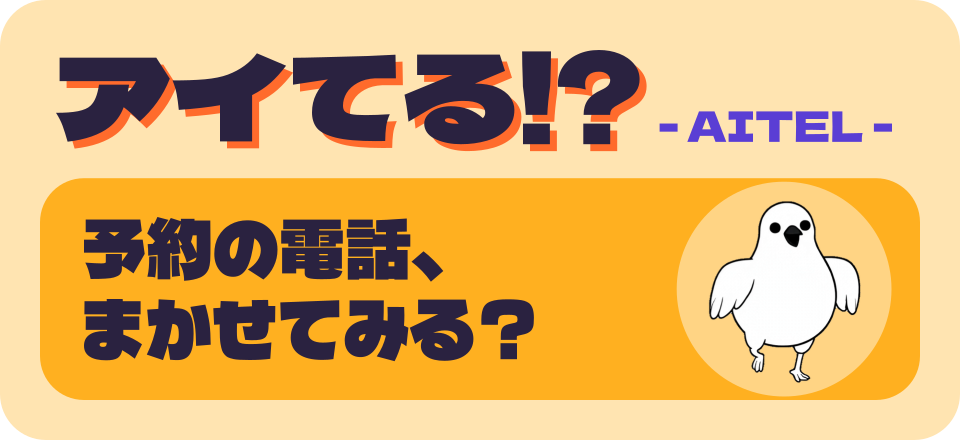
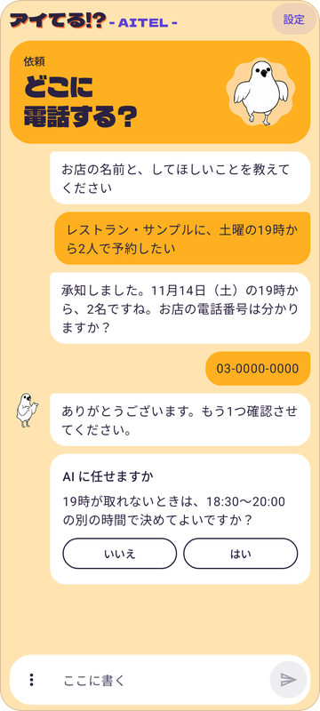
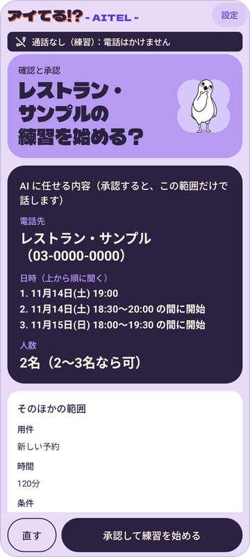
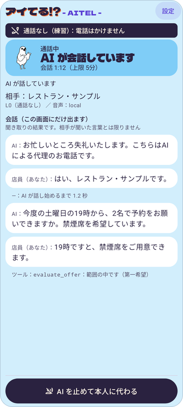
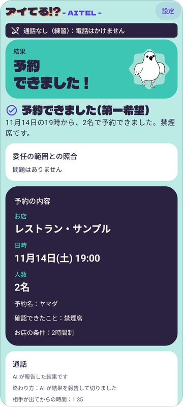

<p align="center">
  
</p>

# アイてる!? のアプリ（apps/rotep）

アイてる!? - AITEL - の本体です。rotep は開発のときの名前で、フォルダやパッケージの名前に残っています。予約の電話を AI に任せます。通話の声は Gemini、次に言うことを決めるのは Claude Sonnet 5.5 です（[ADR-053](../../docs/decisions.md)。設定で Gemini Live だけの形に戻せます）。名前は AI ＋ TEL で、日本語で読むと「アイてる!?」、つまり「予約、空いてる？」です。

どんなアプリかは、リポジトリの [README](../../README.md) に、スマホに入れて使い始める手順は [docs/install.md](../../docs/install.md) にまとめています。ここは、作る人・試す人向けのくわしい話です。

| 項目 | 値 |
| --- | --- |
| 名前 | アイてる!? - AITEL -（[ADR-030](../../docs/decisions.md)） |
| ホーム画面での名前 | アイてる!?（診断の画面は、設定の「困ったとき」の「診断の画面を開く」から開きます） |
| パッケージ名 | `io.github.incallagent.rotep` |
| Gradle のプロジェクト | `:apps:rotep` |
| APK | `apps/rotep/build/outputs/apk/debug/rotep-debug.apk`（`./gradlew :apps:rotep:assembleDebug`） |
| Magisk モジュール | `apps/rotep/build/distributions/debug/incall-agent-rotep-<version>-debug.zip`（`./gradlew :apps:rotep:zipDebug`）。root なしで動かしているので、いまは使っていません |
| Android | 12 以上（minSdk 31）。手伝い役を使う「電話をかける」「全自動で電話をかける」は 14 以上。手元の端末は Nothing Phone (2a)（Android 16）の1台だけで、ほかの端末では、まだ確かめていません |

## いまの状態（2026-11-09）

- コードには「練習」「電話をかける」「全自動で電話をかける」の 3 つの形が入っています（下の「電話のしかた」）
- 端末での確認は途中です。通話なしで AI と話す試験、shell の権限の確認、アプリの通しの練習に加えて、協力者との通話（[a5.md](a5.md) の形。「相手が出た」は手で押した版）で AI の声が相手に届き、結果の報告まで通りました（2026-11-09 12:44）。さらに、協力者との電話で「全自動で電話をかける」（[a4.md](a4.md)）の発信、相手が出たことの読み取り（何も押さない）、AI の名乗り、予約の報告、最後の挨拶のあとアプリから切るまでが通りました（2026-11-09 21:51。AI は相手が出てから約 2.5 秒で話し始めた）。「電話をかける」の読み取りと AITEL からの通話の操作、スピーカーとキーパッド、再起動、Wi-Fi 切れ、指定時刻の電話、カレンダーへの追加は、まだ確かめていません
- 21:51 の電話で見つかった問題（直している最中）：「お忙しいところ」「二名」の読み間違い。予約名が途中で切れても、言えたことにしていた。AI が提案の確認（`evaluate_offer`）を飛ばした
- 最初の発話で AI の声が乱れたので、送話の出だしに直しを入れました。21:51 の電話では、最初の AI の声がはっきり聞こえ（協力者の話）、送話の統計にも乱れはありませんでした（[uplink-start.md](uplink-start.md)）
- 手伝い役をスマホだけで起動する形（PC なし。[ADR-041](../../docs/decisions.md)）を足しました。ペアリングと手伝い役の起動は、スマホで通りました（2026-11-09 の夜）。手伝い役は、ワイヤレスデバッグがオフでも、USB デバッグがオンなら残っていました。USB デバッグも切ったとき、「全自動を許可」のボタン、再起動のあとの起動は、まだ確かめていません。PC の手順は予備として残しています
- Muse や Grok から、自分のサーバーを通して頼む形（[ADR-042](../../docs/decisions.md)）を足しました。作者の提出用のサーバーは Cloud Run で動かしています。Muse と Grok からスマホに依頼が届き、スマホで断ると AI に `declined` が返りました（電話なし）。サーバーを通した依頼で電話するところまでは動きましたが、電話の結果を AI が読むところまでの通しは、まだ確かめていません
- 電話の記録（[ADR-045](../../docs/decisions.md)、[ADR-050](../../docs/decisions.md)）、結果の画面と通話中のボタン（[ADR-046](../../docs/decisions.md)）、お店からの折り返しの通知（[ADR-047](../../docs/decisions.md)）を足しました。スマホでは、まだ確かめていません
- 開発者向けオプションを普段は切っておく形（[ADR-049](../../docs/decisions.md)）を足しました。エミュレータでだけ通していて、Nothing Phone では、まだ確かめていません
- 通話の考える役を Claude にしました（二重モデル。[ADR-053](../../docs/decisions.md)。既定はオン）。二重モデルの通話は、IVRy の公開デモ（AI の受付）への電話で予約成立まで通りました（2026-11-10）。協力者との二重モデルの電話は、まだです。上に書いた協力者との通話の結果は、Gemini だけで話す形のものです

## 画面

<p align="center">
  
  
  
  
</p>

| 画面 | すること |
| --- | --- |
| 会話（最初の画面） | 頼みたいことを書くと、考えるモデル（Claude Sonnet 5.5）が足りないことを聞き、条件を整理して依頼を作る。店名、電話番号、予約名、連絡先は、書いた文字にあるものだけが入る。任せる範囲、予算、人数の幅、聞かれたら伝えてよいことは、アプリの「はい／いいえ」のボタンで答える。店名（予約や変更なら希望の日時も）が分かると、Claude のウェブ検索でお店を調べ、結果を出典つきで会話に出す（電話番号は送らない）。希望の時間に合わないときは AI がそう伝える。練習では実在の番号は要らない。そろうと大きな「確認へ」が出る。「手で入力する」「いまの内容」「やり直す」は入力欄の横の ⋮ の中。書いたことは電話番号も含めて Anthropic に送られ、会話はアプリに残さない（この説明は設定の Claude の欄にもある）。通話中に Anthropic に送るものは、下の設定の行を見る。電話の記録が 1 件以上あれば、会話を始める前に幅いっぱいの細いカード「電話の記録（n 件）」が出て、押すと履歴が開く（通話中は出ない）。記録が 1 件もなく、実際に発信した電話の結果が残っているとき（記録をオフにしたときなど）は、代わりに「前回の電話」のカードが出る。履歴は 1 件を 1 枚のカードにして、カードごとに「コピー」がある |
| 依頼のフォーム | 会話の ⋮ の「手で入力する」から入る。店名、電話番号、種類、用件、希望の日時と幅、人数と幅、予約名、連絡先、伝えてよいこと、任せる範囲、通話の上限（15 分まで。二重モデルの通話は長くても 9 分）を手で入れる。協力者の本物の番号で試験をするときは、こちらを使う（かける先の番号を会話に書かないため）。ただし [ADR-038](../../docs/decisions.md) の「番号を外に送らずに試験する」は、二重モデルの通話では成り立たない。かける先の番号は通話の指示に入らないが、連絡先の番号（入れたとき）と相手の言葉の文字起こしは、通話中に Anthropic に送られる。「練習用の例を入れる」で架空の例が入る。電話の記録が 1 件もなく、実際に発信した電話の結果が残っているときは、見出しのすぐ下に「前回の電話」のカード（結果の見出し、店名、終わった日時）が出て、「結果を見る」で読み直せる |
| 確認と承認 | AI に任せる内容、「内容の確認」（検査の結果）、電話のしかたを見る。問題がなければ「承認して電話する」（練習では「承認して練習を始める」）。「全自動で電話をかける」のときは「時間を指定して電話する」で日時を選んで承認できる（[手順](scheduled-call.md)。最初の画面に帯が出て、取り消せる。ほかの AI が時刻を希望しているときは「ほかの AI の希望：11月10日(火) 11:00」のように出るが、決めるのは本人）。「直す」で依頼に戻る。会話で調べた結果があれば、「確かめました」の形で出る。ないときは「お店を調べる」で電話の前の下調べができる（押したときだけ）。取り消しと練習用の番号のときは、どちらも出ない。ほかの AI から届いた依頼では、上に「ほかの AI から届いた依頼です」と、確かめてほしいことが出る。承認のボタンのすぐ上に、送り先の 1 行（考える役が Claude のときは「電話の相手の声は Google に、相手の言葉の文字と依頼の内容は Anthropic に送られます」）が出る。夜 9 時から朝 8 時は「いまは夜遅い時間か早朝です。お店が閉まっている時間かもしれません」と注意が出る（止めない。練習では出ない） |
| 通話中 | 状態（「電話をかけています」「相手が出るのを待っています」「AI が会話しています」「電話を終えるところです」「電話が終わりました」など）、経過時間と上限、相手の店名、会話の文（この画面にだけ出る）。「AI を止めて本人に代わる」。マイクを止める／戻す、電話の画面を開く、電話を切る（「全自動で電話をかける」ではスピーカーとキーパッドも）。相手が出たことはアプリが読み取り、読み取れないときだけ「相手が出た」「切った」が出る。AI が通話に出ている間は「少し待ってもらう」「断って終える」の固定のボタンが出る（自由な文の指示はできない） |
| 結果 | 結果と要約、「任せた内容と合っているか」（委任の範囲との照合）、予約の内容、折り返しが要ること。「続けて頼む」の欄に、予約が取れたら「変更」「取り消し」、取れなかったら「続き」（取り消しが済んだときと、問い合わせに答えてもらえたときは出ない）。電話をかけられなかったときは「電話をかけていません」と出て、照合、通話の欄、「続けて頼む」は出ない。「最初に戻る」。「前回の電話」から開いたときは「前回の電話の結果です」と出て、「この結果を消す」で消せる。つながらなかったとき、途中で切れたとき、AI が報告しなかったとき、相手が出る前に終わったときは、要約の下に次の一手が 1 行出る（番号を確かめてかけ直す、お店に確かめる、など）。本人が止めた電話は「途中で止めました」と出て、「折り返しが要ること」に確かめることが出る |
| 設定 | Gemini API キー、Claude API キー（会話で依頼を作るときと、通話の考える役に使う）、通話の考える役（通話の考える役に Claude を使う。既定はオン。オンのときは Claude のキーがないと練習も電話も始められず、相手の言葉の文字起こしと依頼の内容が Anthropic に送られる。切ると Gemini だけで電話する）、電話のしかた（練習／電話をかける／全自動で電話をかける）、通話の音（この端末で鳴らすか）、AI の話し方（ゆっくり話す）、カレンダー（予約が取れたら Google カレンダーに追加する）、お店からの折り返し（お店からの折り返しを知らせる。既定はオフ）、練習のとき（スピーカーで鳴らすか、AI が話す間はマイクを止めるか）、電話の記録（電話の記録を端末に残す。既定はオン。「記録を見る・消す」）、ほかの AI からの依頼（サーバーの URL と端末のトークン。設定しなければ何もしない）、開発者向けオプション（開発者向けオプションを普段は切っておく。既定はオフ）、困ったとき（端末のマイクを止めない、診断の画面を開く）、このアプリについて（版、ライセンス、プライバシーのページ、オープンソースのライセンスの全文） |
| ほかの AI からの依頼（画面の上の帯） | 通話がないときは、どの画面でも、上に「ほかの AI から電話の依頼が届きました」の帯が出る（通知も出る）。店名と用件、「内容を見る」「断る」。届いても画面は勝手に変わらず、「内容を見る」を押したときだけ確認の画面に進む。電話は本人が承認したときだけかかる。通話中は出ない。通話のすぐあとの結果の画面では、「最初に戻る」のあとで見られることだけを知らせる |
| 診断の画面 | 設定の「困ったとき」の「診断の画面を開く」から開く。「PC なしの起動」（ペアリング、手伝い役の起動、全自動の許可、電話の準備を試す。「案内」で最初の準備を順に見られる）、1. 手伝い役の起動（PC で打つコマンド）、2. 手伝い役の状態と「終了」、3. 環境の報告、4. 受話の音量、5. 送話の試験 |

診断の画面のほかは、どの画面にも、上に「アイてる!? - AITEL -」の題が出ます。「練習」のときは、帯の文と、確認と結果の画面で練習だと分かります。上の写真は、練習用の架空のお店です。画面の見本は Android Studio の Preview（`ui/preview/`）で見られます。

## 電話のしかた

設定の「電話のしかた」で 3 つから選びます（最初は「練習」）。いま選んでいる形は、確認の画面の「電話のしかた」に出ます。開発の資料では、L0、L2、L3 の名前でも呼んでいます（L1 は、AI の声を端末のスピーカーで鳴らす形で、設定から外しました）。

| 電話のしかた | 段階 | だれが何をするか |
| --- | --- | --- |
| 練習（電話はかけません） | L0 | 電話はかけない。本人が店員の役をする（端末のマイクとスピーカー） |
| 電話をかける（相手が出たら AI が話し始めます） | L2 | 発信はアプリ。相手が出たことは手伝い役が読み取り、AI が話し始める。端末のマイクを止める、電話を切るも AITEL から。スピーカーとプッシュ音は電話の画面で（手順は [a6.md](a6.md)） |
| 全自動で電話をかける（時間を指定した電話に使います） | L3（本命） | 発信、相手が出たこと、端末のマイクを止める、プッシュ音、終話をアプリが行う（`TelecomCallControl`）。許可が要る（[a4.md](a4.md)） |

- 発信から終話までアプリが行う「全自動で電話をかける」を本命にしています（[ADR-031](../../docs/decisions.md)）。端末では、協力者との電話で 1 回、発信から切るまで通りました（2026-11-09 21:51。[a4.md](a4.md)）
- 手伝い役は、shell の権限のプロセスです。アプリは通話の音の出し入れをこれに頼みます（`ShellAudioPath`）。起動のしかたは下の「手伝い役の起動」です。手伝い役は `HelperProvider` を通して、アプリに Binder を渡します。Shizuku は使いません（理由は「メモ」）
- 「電話をかける」と「全自動で電話をかける」で手伝い役が動いていないときは、設定と確認の画面に「手伝い役が動いていません。…」と出て、電話はかけられません。音の出ない電話をかけないためです
- 通話に流す方式は direct（出力先を `TYPE_TELEPHONY` にして鳴らす形）だけを使います（2026-11-09 の協力者との通話で届いた方式）。ほかの方式（redirection、スピーカー）は設定から外しました。診断の画面の試験でだけ試せます（[a3.md](a3.md)）
- AI の声が相手に届かないときだけ、設定の「困ったとき」の「端末のマイクを止めない」をオンにします。静かな部屋で使い、AI が話す間は本人は話さず、電話の画面でも端末のマイクを止めません（止めると AI の声が届きません）

## 依頼と電話のこと

- 用件は4つです：新しい予約、予約の変更、予約の取り消し、問い合わせ。取り消しは、予約名と取り消す予約（日時など）を入れます。キャンセル料があると言われたときは、「キャンセル料がかかっても取り消してよい」をオンにしていない限り、取り消さずに本人に返します
- AI の決まり：どの電話でも、自動音声のあとに人が出たらもう一度 AI だと名乗る、確定のボタンは押さない、「本人ではなく、本人の代理の AI です」と答える、医療の判断は受けない（`SpeakingStyle`）
- 電話の前の下調べ：会話では、店名（予約や変更なら希望の日時も）が分かると、Claude のウェブ検索で調べて、出典つきで会話に出します（電話番号は送りません。1 つの会話で 3 回まで）。会話で調べた結果がないときは、確認の画面の「お店を調べる」を押すと、Gemini の Google 検索で、お店の営業時間や予約の受け方を調べて、そこに出します（押したときだけ送ります。送るのはお店の名前と番号、希望の日時と人数で、予約名や連絡先、自由に書いた欄は送りません。Google 側に一定の期間残ります。検索は月 5,000 回まで無料で、それを超えると 1,000 回につき 14 ドルです）。合わない日時は、電話の前に直せます。結果は検索の決まりにより、書き換えずにそのまま出します。「お店を調べる」で調べたら、確かめるまで「承認」は押せません（会話で調べた結果では止まりません）。取り消しと、練習の例では出ません。お店ではない番号（試験の相手の番号など）では押さないでください
- 通話の音：既定では、AI が話している間、端末から通話の音を出しません（お店と AI の会話は聞こえません）。手伝い役が通話の音を消し、AI があなたに代わるときと、通話が終わったときに戻します。設定の「通話の音をこの端末で鳴らす」をオンにすると、聞こえます
- カレンダー：設定の「予約が取れたら Google カレンダーに追加する」をオンにすると（既定はオフ。オンにするときにカレンダーの許可を求めます）、実際に発信した電話で予約が取れて、結果の画面の「任せた内容と合っているか」に問題がないときだけ（新しい予約と変更）、この端末のメインのカレンダー（端末の Google アカウントの主のカレンダー）に予定が入ります。結果の画面の「取り消す」で消せます。オフのときは、結果の画面の「カレンダーに追加」で、カレンダーのアプリの追加画面を開きます。アプリに残すのは結果を指す値と予定の id だけで、店名や番号は残しません（[ADR-039](../../docs/decisions.md)）
- 結果から続けて頼む：結果の画面の「変更」「取り消し」「続き」は、依頼のフォームをアプリの値で埋めるだけで、電話はかけません（確認の画面の承認は毎回）。AI は通しません。お店の言葉と AI の要約は入れません。「変更」「取り消し」は、任せる範囲を既定の「しない」から始めます。電話番号は、通話の直後ならそのまま入ります。「前回の電話」から開いたときは、その電話が電話の記録に残っていれば番号も入り、なければ入れ直します（[ADR-046](../../docs/decisions.md)）
- 通話中のボタン：「少し待ってもらう」「断って終える」は、アプリの固定の文を AI に伝えます。自由な文の指示と、人数や時間の範囲を広げるボタンはありません。「断って終える」は、AI が断りの言葉を言ったら電話を切ります（長くても 15 秒）。押したあとは、AI が予約の報告をしていても予約として扱いません（[ADR-046](../../docs/decisions.md)）
- 電話の記録：既定でオンです。実際にかけた電話の店名、電話番号、用件、取れた日時、人数、予約名、結果、要約、文字起こし（お店と AI の発言の文字）を、暗号化して端末に残します。確認の画面で毎回そのことを伝えます。切るときは設定の「電話の記録を端末に残す」です（値がすでに保存されている端末では、更新で変えません）。90 日、50 件まで。最初の画面の「電話の記録（n 件）」か、設定の「記録を見る・消す」で開きます。1 件を 1 枚のカードで見せ、1 件ずつコピーできます（`EXTRA_IS_SENSITIVE` を付けます）。1 件ずつでも全部でも消せます。オフにしても自動では消えません。音声と、練習、発信できなかった電話は残しません。記録の文字起こしと要約は、次の通話の AI の指示文に入れません（[ADR-045](../../docs/decisions.md)、[ADR-050](../../docs/decisions.md)）
- お店からの折り返し（既定はオフ）：設定の「お店からの折り返しを知らせる」をオンにすると、電話の記録に残っている電話の番号から着信があったときに、「前に電話した○○からの着信かもしれません」と通知します。このアプリを端末の「発信者番号と迷惑電話」のアプリに選ぶ確認が出ます（`ROLE_CALL_SCREENING`。端末で 1 つのアプリだけで、ほかの迷惑電話のアプリは外れます。オフにしても選ばれたままで、何もしません。外すときは端末の設定から外します）。着信は止めません。通知は音なしで、店名が出るのでロック中は出ません。連絡先にある番号と、番号を通知しない着信は対象外です。着信の番号はアプリの外に出さず、保存もせず、記録の番号と照らし合わせるだけです（[ADR-047](../../docs/decisions.md)。手順は [diagnostics.md の 10 節](diagnostics.md#10-お店からの折り返しの通知adr-047)）

## 使い方（練習：電話はかけない）

1. APK を入れる：`adb install -r apps/rotep/build/outputs/apk/debug/rotep-debug.apk`
2. 設定 → Gemini API キー（有料枠）を貼り付けて保存する。Claude API キーも貼り付けて保存する（通話の考える役と、会話で依頼を作るときに使う。設定の「通話の考える役に Claude を使う」を切って手で入れるだけなら要らない）
3. 会話の ⋮ の「手で入力する」（Claude API キーがないときは、最初の画面の「手で入力する」。「通話の考える役に Claude を使う」がオンのままだと、確認の画面で止まる） → 「練習用の例を入れる」 → 「確認へ」 → 「承認して練習を始める」（マイクと通知の許可を求められたら許可する）。会話で試すときは、頼みたいことを書く。練習では実在の番号は要らない。そろうと「確認へ」が出る
4. AI が「こちらはAIによる代理のお電話です」と話し始める。お店の店員の役で答える
5. AI が結果を報告して切ると、結果の画面が出る

困ったときは「AI を止めて本人に代わる」を押します。通話の上限の時間になったとき、AI との接続が切れたとき、端末のマイクとスピーカーが止まったときも、AI は止まり、音で知らせます。どの終わり方でも、結果の画面が1回出ます（練習の結果は保存しません）。

設定の「練習のとき」では、スピーカーで鳴らすか（切ると受話口やイヤホン）と、AI が話している間はマイクを止めるかを選べます。後者は、AI が自分の声で止まってしまうとき用です（そのかわり、AI の話に割り込めなくなります）。

## 手伝い役の起動

「電話をかける」と「全自動で電話をかける」は、手伝い役が動いているときだけ使えます。起動のしかたは 2 つあります。どちらで起動しても同じ手伝い役が動き、扱いも同じです（「終了」で終わる、アプリを入れ直すと自分で終わる、など）。どちらも、様子は診断の画面（設定の「困ったとき」の「診断の画面を開く」）で見ます。

### PC なしで起動する（ワイヤレスデバッグ）

> [!NOTE]
> ペアリングと手伝い役の起動は、スマホで通りました（2026-11-09 の夜）。再起動のあとの起動、Wi-Fi が切れたとき、「全自動を許可」のボタンは、まだ確かめていません（エミュレータでは通しました）。通らないときは、下の「PC から起動する」を使います。

アプリ自身がスマホの adbd（127.0.0.1 だけ）につないで、PC と同じ起動のスクリプトの本文を実行します（[ADR-041](../../docs/decisions.md)）。手順の全体と、うまくいかないときのことは [diagnostics.md の 9 節](diagnostics.md#9-pc-なしの起動ワイヤレスデバッグ) にあります。最初の準備は、診断の画面の「案内」でも順に見られます。

- 要るもの：Wi-Fi（ワイヤレスデバッグは Wi-Fi のときだけ使えます）、開発者向けオプション、通知の許可
- 最初の 1 回（ペアリング）：診断の画面の「PC なしの起動」で「ペアリングを始める」を押します。「ワイヤレス デバッグ」をオンにして「ペア設定コードによるデバイスのペア設定」を開き、その画面を閉じずに、通知へ 6 桁のコードを入れます
- 毎回：ワイヤレスデバッグをオンにして「手伝い役を起動」を押します。「2. 手伝い役の状態」が「動いている」になれば起動できています
- 「全自動で電話をかける」を使うとき：「全自動を許可」を 1 度押します（PC の `appops set` と同じです。再起動しても残ります）
- 再起動のあと：ペアリングしてあれば、Wi-Fi につながったところでアプリが自分で起動します（診断の画面のスイッチでオフにできます）。起動の直後は 1〜2 分かかることがあります。自動で起動できないときは通知で知らせます
- アプリを更新したあと：「手伝い役を起動し直してください」と通知します。通知の「起動」で起動します
- USB デバッグ：ワイヤレスデバッグがオフでも、USB デバッグがオンなら手伝い役は残っていました（端末で確かめました）。どちらもオフになると止まります（ソースから分かることで、端末では確かめていません）。Wi-Fi が切れたときにも残すため、USB デバッグはオンのままにします。USB デバッグがオンだと起動しない銀行のアプリがあります
- 普段は開発者向けオプションを切っておく（任意。既定はオフ。[ADR-049](../../docs/decisions.md)）：設定の「開発者向けオプション」のスイッチをオンにすると、電話の前にアプリが USB デバッグとワイヤレスデバッグをオンにして手伝い役を起動し、ワイヤレスデバッグはすぐに戻します。電話のあとで手伝い役を止めて、USB デバッグも元に戻します。最初のペアリングと手伝い役の起動は手で行います。電話のときは「常に許可」にした Wi-Fi が要ります。エミュレータでだけ通していて、Nothing Phone では、まだ確かめていません（[diagnostics.md の 11 節](diagnostics.md#11-開発者向けオプションを普段は切っておくadr-049)）

### PC から起動する（予備）

協力者との通話（2026-11-09）で動いたのは、この形です。手順の全体は [diagnostics.md](diagnostics.md) の 4-1、4-2、スクリプトは [helper/rotep-helper.sh](helper/rotep-helper.sh) です。リポジトリの一番上のフォルダで、PowerShell で実行します（Git Bash では、各コマンドの前に `MSYS_NO_PATHCONV=1` を付けます）

```bash
adb push apps/rotep/helper/rotep-helper.sh /data/local/tmp/rotep-helper.sh
adb shell sh /data/local/tmp/rotep-helper.sh
```

1行目は最初の1回だけです（スクリプトを変えたときも）。診断の画面の「2. 手伝い役の状態」が「動いている」になり、`uid=2000` と出れば起動できています。

手伝い役は、一度起動すれば USB を抜いても動き続ける作りです（端末では、まだ確かめていません）。終わらせるときは診断の画面の「終了」を押します。端末を再起動したときと、アプリを入れ直したときは、上の2行目のコマンドで起動し直します（[diagnostics.md](diagnostics.md) の 4-2、4-6）。

## 使い方（「電話をかける」）

アプリが電話をかけて、AI の声を手伝い役で通話に流す形です。相手が出たことは手伝い役が読み取ります。読み取れないときだけ、本人が「相手が出た」を押します。くわしい手順、数えること、うまくいかないときは [a5.md](a5.md) と [a6.md](a6.md) にあります。この形は端末では、相手が出たことを手で知らせていた版まで確かめています（2026-11-09）。

1. APK を入れて、手伝い役を起動します（上の「手伝い役の起動」）
2. 設定 → 「電話のしかた」を「電話をかける」にします
3. 依頼を入れて「確認へ」を押します。確認の画面に「電話のしかた：電話をかける」と出ていることを確かめて、「承認して電話する」を押します。アプリが、承認した番号にだけ電話をかけます（試験の相手の番号は、会話に書かず「手で入力する」で入れ、「お店を調べる」も押しません。番号が外部の AI に送られるためです）
4. 相手が出て電話がつながると、AI が話し始めます（読み取れないときは「相手が出た」が出るので、押します）。端末のマイクはアプリが止めます（設定の「端末のマイクを止めない」がオンのときは止めません）
5. AI が、AI だと名乗って話します。プッシュ音が要るときは、押す番号の案内が出るので、電話の画面のキーパッドで押します
6. AI が結果を報告して電話を切ると、結果の画面が出ます。アプリが切れないときだけ、「電話の画面で電話を切ってから、「切った」を押してください」と出ます。押し忘れても、1 分たつとアプリの側は終わり、電話の画面で確かめるよう案内します

途中で「AI を止めて本人に代わる」を押したときは、アプリが端末のマイクを戻すので、そのまま自分で話します。自分で切るときは、通話の画面の「電話を切る」を押します。

## 使い方（「全自動で電話をかける」）

アプリがかけた1本を、画面のない InCallService（`RotepInCallService`）で操作する形です。このサービスはふだん無効で、アプリが AI の通話をかける直前に有効にし、通話が終わったら無効に戻します。端末では、協力者との電話で 1 回通りました（2026-11-09 21:51）。同じ電話で見つかった問題は、直している最中です（上の「いまの状態」）。試すときは、先に「電話をかける」の通話（[a5.md](a5.md)）が通っていることを確かめます。くわしい手順、つながらないときの切り分け、合格の条件は [a4.md](a4.md) にあります。

1. 上の「手伝い役の起動」のとおりに、手伝い役を起動します
2. `MANAGE_ONGOING_CALLS` の AppOps を許可します。診断の画面の「全自動を許可」を押すか（スマホでは、まだ確かめていません）、PC から adb で次を実行します（`pm grant` では付きません）

   ```bash
   adb shell appops set io.github.incallagent.rotep MANAGE_ONGOING_CALLS allow
   ```

3. 設定 → 「電話のしかた」を「全自動で電話をかける」にします。許可がないときは、その下に「全自動で電話をかける許可がありません」と出ます
4. 依頼を入れて「確認へ」を押します。「電話のしかた：全自動で電話をかける」と出ていることを確かめて、「承認して電話する」を押します（試験の相手の番号では「お店を調べる」を押しません）。電話の許可を求められたら許可します（ほかの通話の途中かを確かめるため `READ_PHONE_STATE` も使います）
5. 相手が出ると、AI が話し始めます。端末のマイクを止める（「端末のマイクを止めない」がオンのときは止めません）、プッシュ音、終話はアプリが行い、結果の画面が出ます
6. 試したあとは毎回、AppOps を元に戻します。この許可は再起動しても残り、`appops reset` でも消えません。戻すのは PC の adb からです（アプリの画面には、戻すボタンはありません）。残りの後片付けは [a4.md](a4.md) の 5 節です

   ```bash
   adb shell appops set io.github.incallagent.rotep MANAGE_ONGOING_CALLS default
   ```

## ほかの AI から頼む（MCP）

届いた依頼は、アプリの帯の「内容を見る」から確認の画面に進み、本人が承認したときだけ電話します。入口は 2 つあります。

### Muse・Grok から（自分のサーバーを通す）

> [!WARNING]
> Muse と Grok から、作者の提出用のサーバー（Cloud Run）を通してスマホに依頼が届き、スマホで断ると AI に `declined` が返りました（電話なし。2026-11-10）。電話の結果を AI が読むところまでの通しは、まだ確かめていません。テストは、本物の HTTP サーバーと偽のスマホ（[server/test_aitel_relay.py](server/test_aitel_relay.py)）と、標準の MCP クライアントで通しています。

Muse や Grok はクラウドの AI なので、自分で立てた窓口のサーバーを通します（[ADR-042](../../docs/decisions.md)）。PC は要りません。アプリからサーバーへ取りに行く形で、外からスマホには入りません。

1. サーバーを立てます：[docs/mcp-setup.md](../../docs/mcp-setup.md)（トークンは AI 用と端末用の 2 つ）
2. スマホの「設定」→「ほかの AI からの依頼（サーバー）」に、サーバーの URL と端末用のトークンを入れて保存します。アプリを開いている間はすぐに届きます。閉じている間は 15 分ごとに取りに行って、通知を出します（スマホが省電力の状態だと、1 時間以上遅れることがあります）
3. Muse と Grok を登録します：同じ文書の「Grok を登録する」「Muse を登録する」

電話をかける時刻（`call_at`）の希望が付いた依頼では、確認の画面の「時間を指定して電話する」に「ほかの AI の希望：11月10日(火) 11:00」のように出ます。時刻を決めて承認するのは本人です。

### パソコンの AI から（USB）

パソコンの AI から、USB（adb）で AITEL に電話の依頼を渡せます。つなぎ方と決まりは [mcp/README.md](mcp/README.md) にあります。

## AI の話し方

話すエージェントへの指示文は、`agent-live` モジュールが委任ポリシーから作ります。このアプリは、その後ろに自分の話し方の決まり（お客の側の敬語、1つずつ伝える、今年の日付は年を言わない、1文を短く）を足して送ります（`call/SpeakingStyle.kt`、`call/RotepLive.kt`）。設定の「AI の話し方」で、「ゆっくり話す」を選べます。

## 安全のための決まり

- かける番号は、承認した委任ポリシーの番号だけ。緊急の番号、短い番号、国際電話と事業者を選ぶ番号（00・010）、有料の情報サービスの番号（0990・0180・0170）、練習用の架空の番号にはかけない。ナビダイヤル（0570）は止めず、確認の画面に注意を出す
- 緊急の番号は、端末の判定（`TelephonyManager.isEmergencyNumber`）でも断る。練習でも使わない
- 「全自動で電話をかける」で操作するのは、アプリがかけた1本だけ（全桁の番号と、通話が作られた時刻で見分ける）。ほかの通話と緊急通報には何もしない。会議通話になったら、AI を止めて本人に代わる
- どちらの電話の形でも、ほかの通話の途中には発信しない（「電話をかける」で、手伝い役が通話の様子を読めないときは発信して、ボタンで知らせる形になる）。相手が出たあとに保留やほかの通話になったら、AI を止めて本人に代わる
- ほかの AI からの依頼も、同じ検査を通し、承認は確認の画面でだけ行う。サーバーの URL と端末のトークンを設定しなければ、サーバーには何も送らない。設定すると、依頼の中身と結果がそのサーバーを通る（サーバーはメモリだけに置き、ディスクにもログにも書かない）
- ログに、電話番号・名前・会話の文・API キーを出さない（[ADR-021](../../docs/decisions.md)）
- API キーは、AndroidKeyStore の鍵（端末の外に出せない鍵）で暗号化して、アプリの中の `noBackupFilesDir` に置く。クラウドへのバックアップにも、端末どうしの引っ越しにも入らない。保存したらクリップボードを消す。読めなくなったら消して、貼り直しを頼む
- API キーの扱いと、漏れる可能性が残るところは、リポジトリの [README の「API キーの管理」](../../README.md#api-キーの管理) にまとめています
- AI が最初の発話で AI だと名乗らなければ、名乗り直すように伝える。次の発話でも名乗らなければ、AI を止めて本人に代わる
- 通話の音声は保存しない。会話の文は、設定の「電話の記録」がオンのとき（既定でオン）暗号化して端末に残す（ADR-045、ADR-050）
- 電話の途中でアプリが終わったら、次に開いたときに「結果が分かりません」と知らせる（そのために、電話の間だけ店名を 1 件、暗号化せずに残す。番号は残さない）
- shell の権限を持つほかのアプリ（Shizuku 系など）と一緒に使わない（依頼を置いたり、手伝い役を入れ替えたりできるため）
- 「電話の記録」がオフのとき端末に残すのは、最後の電話の結果（店名、要約、予約の内容と予約名、折り返しが要ること、終わった日時と終わり方）の 1 件だけ。アプリの中の `noBackupFilesDir` に置き、次の電話で入れ替わる。結果の画面で消せる。電話番号の欄は持たない（AI の要約に、お店が言った番号が入ることはある）。練習の結果と、発信できなかったときの結果は残さない

## 端末で確かめる順番

電話をかける形は、次の順に確かめます。相手は、説明して同意をもらった協力者だけです（協力者の端末にかけるので、2 台目の端末は要りません）。お店や会社にはかけません。

| 順 | 手順書 | 確かめること | いま（2026-11-09） |
| --- | --- | --- | --- |
| 1 | [diagnostics.md](diagnostics.md) | 手伝い役：PC の adb から起動して、ちゃんと終わる。環境の報告が取れる。相手が話すと受話の音量が動く | 手伝い役は協力者との通話で動いた。この手順の個別の確認は行っていない |
| 1b | [diagnostics.md の 9 節](diagnostics.md#9-pc-なしの起動ワイヤレスデバッグ) | PC なしの起動：ペアリング、手伝い役の起動、全自動の許可、再起動のあとの起動 | ペアリングと手伝い役の起動は通った（2026-11-09 の夜）。ワイヤレスデバッグがオフでも、USB デバッグがオンなら手伝い役は残った。全自動の許可、USB デバッグも切ったとき、再起動のあとの起動は、まだ（エミュレータでは通した） |
| 2 | [a3.md](a3.md) | 送話（A3）：目印の音が相手に届く方式を見つける | 目印の音の試験は行っていない。AI の声は届いた（direct の方式） |
| 3 | [a5.md](a5.md) | AI の通話（A5）：「電話をかける」で会話が最後まで進み、結果が1つ残る。通話の音を消す形（既定）も確かめる | 通った（「相手が出た」は手で押した版）。通話の音を消す形は、まだ |
| 4 | [a6.md](a6.md) | AITEL の画面での操作：相手が出たことの読み取りと、通話の画面のボタン | まだ |
| 5 | [a4.md](a4.md) | 通話の操作（A4）：「全自動で電話をかける」で、アプリがかけた1本を自動で操作できる | 発信、相手が出たことの読み取り、AI の名乗り、アプリからの終話は通った（2026-11-09 21:51）。ミュート、プッシュ音、保留、ほかの通話は、まだ |
| 6 | [scheduled-call.md](scheduled-call.md) | 時間を指定した電話：画面がロックされていても、指定の時刻に AI が最後まで済ませる | まだ |
| 7 | [docs/mcp-setup.md](../../docs/mcp-setup.md)、[server/README.md](server/README.md)、[mcp/README.md](mcp/README.md) | サーバーを通した依頼：Muse・Grok から頼んで、スマホで承認して電話し、ほかの AI が結果を読める | 途中まで（Muse と Grok からスマホに届き、断ると AI に `declined` が返った。サーバーを通した依頼で電話するところまでは動いた。電話の結果を AI が読むところまでの通しは、まだ） |
| 8 | [diagnostics.md の 10 節](diagnostics.md#10-お店からの折り返しの通知adr-047) | お店からの折り返しの通知：着信は止めず、電話の記録にある番号だけ通知する | まだ（エミュレータでだけ通した） |
| 9 | ― | 電話の記録、結果の画面の「変更」「取り消し」「続き」、通話中の「少し待ってもらう」「断って終える」 | まだ |
| 10 | [diagnostics.md の 11 節](diagnostics.md#11-開発者向けオプションを普段は切っておくadr-049) | 開発者向けオプションを普段は切っておく形：主スイッチがオフのまま、電話の間だけ動く | まだ（エミュレータでだけ通した） |

## PC で Gemini Live への接続を確かめる

キーをクリップボードにコピーしてから、リポジトリの一番上で（Windows PowerShell）：

```powershell
$env:JAVA_HOME = "C:\Program Files\Android\Android Studio\jbr"; $env:GEMINI_API_KEY = (Get-Clipboard -Raw).Trim(); .\gradlew --no-daemon :apps:rotep:testDebugUnitTest -PliveSmoke; Remove-Item Env:\GEMINI_API_KEY
```

結果は `apps/rotep/build/live-smoke/result.txt` に出ます（キーは入りません）。`-PliveSmoke` を付けないふだんのビルドでは、このテストは飛ばされます。

## メモ

- Shizuku は 2026-11-07 にやめました。Shizuku 13.6.0 では、Android 16 の Nothing Phone (2a) で手伝い役を起動できなかったためです（`LoadedApk.makeApplicationInner` のところで止まりました）。shell の権限そのものは足りていた（G1 は合格）ので、PC の adb から手伝い役を直接起動して、アプリの ContentProvider（`HelperProvider`）に Binder を渡す形にしました（[ADR-027](../../docs/decisions.md)）
