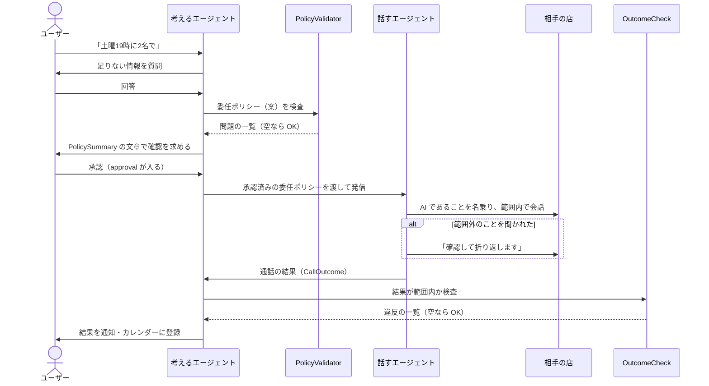

# 委任ポリシー（案）

委任ポリシーは「この電話で、AI にどこまで任せるか」を決めたものです。
考えるエージェントが作り、ユーザーが承認し、話すエージェントはその範囲の中だけで会話します。
範囲外のことは自分で決めず、「確認して折り返します」で通話を終えます（[design.md](design.md) の「設計方針として守ること」）。

アプリが使う共通の約束ごとなので、`core` に置いています。

| 置き場所 | 内容 |
| --- | --- |
| `core/src/main/kotlin/io/github/incallagent/core/policy/DelegationPolicy.kt` | 委任ポリシーのデータの形 |
| `.../CallOutcome.kt` | 通話の結果のデータの形 |
| `.../PolicyValidator.kt` | 委任ポリシーの検査（承認の前に必ず通す） |
| `.../OutcomeCheck.kt` | 結果が委任ポリシーの範囲内かの検査（カレンダーに入れる前に必ず通す） |
| `.../PolicySummary.kt` | 承認画面に出す日本語の文章 |
| `.../PolicyJson.kt` | JSON への変換（保存、エージェント間の受け渡し、LLM の出力） |
| [examples/delegation-policy.example.json](examples/delegation-policy.example.json) | 例。単体テストもこのファイルを使う |

> [!NOTE]
> これは**案**です（[decisions.md](decisions.md) の ADR-024）。

---

## 1. どこで使われるか



- **承認されていない委任ポリシーで電話をかけてはいけません**（`approval` が空のもの）
- **検査に通らない結果は、カレンダーに入れずにユーザーに確認します**。話すエージェントの聞き間違いや、範囲を超えた約束を最後に止めるためです

---

## 2. 委任ポリシーの中身

### 2-1. 全体

| 項目 | 内容 |
| --- | --- |
| `schemaVersion` | 形式の版。今は `1` |
| `id` | 委任ポリシーごとに一意の値（UUID など）。結果の `policyId` がこれを指す |
| `createdAt` | 作った日時（UTC） |
| `approval.approvedAt` | ユーザーが承認した日時。**空なら未承認** |
| `timeZone` | 日時の基準。既定は `Asia/Tokyo` |
| `target` | 電話先 |
| `purpose` | 用件 |
| `request` | ユーザーの希望 |
| `authority` | AI が自分で決めてよいこと |
| `disclosure` | 伝えてよい情報・伝えない情報 |
| `conversation` | 決まった言い回しと通話の上限 |

### 2-2. `target`（電話先）

| 項目 | 内容 |
| --- | --- |
| `businessName` | 店や病院の名前 |
| `phoneNumber` | かける番号（`03-0000-0000` や `+81 3 0000 0000` の形） |
| `kind` | `RESTAURANT`（飲食）、`SALON`（美容院）、`CLINIC`（病院）、`OTHER` |

### 2-3. `purpose`（用件）

| 値 | 意味 |
| --- | --- |
| `NEW_BOOKING` | 新しく予約する |
| `CHANGE` | 予約を変える（何をどう変えるかは `request.notesForShop` に書く） |
| `CANCEL` | 予約を取り消す |
| `INQUIRY` | 問い合わせだけ（営業時間、空き状況など）。予約はしない |

### 2-4. `request`（ユーザーの希望）

| 項目 | 内容 |
| --- | --- |
| `partySize` | 人数。`preferred`（希望）、`min`〜`max`（この範囲なら AI が受けてよい） |
| `windows` | 開始時刻の候補。**上から順に聞く**。各候補は `earliestStart`〜`latestStart` の間に始まれば受けてよい（同じ時刻なら、その時刻ちょうどだけ） |
| `durationMinutes` | 時間の長さ（「2時間制」など、関係があるとき） |
| `preferences` | 席、コース、担当者などの希望。`required: true` は**条件**（満たせなければ予約しない）、`false` は**できれば** |
| `notesForShop` | 店に伝えてよい一言（「誕生日のお祝いです」など） |

### 2-5. `authority`（AI が自分で決めてよいこと）

`windows` と `partySize` の範囲内での予約は、いつでも AI が決めてよいことです。それ以外は次の項目で決めます。**既定はすべて「しない（折り返す）」**です。

| 項目 | 既定 | 内容 |
| --- | --- | --- |
| `mayAcceptOutsideWindows` | `false` | 候補にない日時での予約 |
| `maxBudgetPerPersonYen` | なし | 1人あたりの金額の上限。なしなら、金額の話になったら折り返す |
| `mayAcceptCancellationPolicy` | `false` | キャンセル料などの条件への同意 |
| `mayAcceptPrepayment` | `false` | 前払い・予約金への同意（支払いの情報は、どちらにしても AI は扱わない） |
| `mayJoinWaitlist` | `false` | キャンセル待ちへの登録 |
| `mayLeaveVoicemail` | `false` | 留守番電話への伝言。しないなら切って「つながらなかった」と報告 |

### 2-6. `disclosure`（伝えてよい情報・伝えない情報）

| 項目 | 内容 |
| --- | --- |
| `reservationName` | 予約名（「ヤマダ」など）。**名乗りには使わない**。店に聞かれたときに伝える |
| `callbackNumber` | 連絡先を聞かれたときに伝える番号。なしなら伝えない |
| `mayTell` | 聞かれたら伝えてよいその他の情報（名前と値の組） |
| `neverTell` | 聞かれても伝えない情報。既定は、クレジットカード番号、銀行口座、暗証番号・パスワード、住所、生年月日、マイナンバー・保険証などの番号、病状や健康に関する詳細 |

### 2-7. `conversation`（決まった言い回しと上限）

| 項目 | 既定 |
| --- | --- |
| `aiDisclosure` | 「お忙しいところ失礼いたします。こちらはAIによる代理のお電話です。」（相手が出たら最初に言う） |
| `fallbackPhrase` | 「その点は確認して、改めてこちらから折り返しご連絡いたします。」（範囲外のときに言って終える） |
| `language` | `ja-JP` |
| `maxCallSeconds` | `300`（5分） |

---

## 3. 検査のルール（`PolicyValidator`）

考えるエージェント（LLM）が作った委任ポリシーは、**ユーザーに見せる前に**この検査を通します。問題があれば、ユーザーに聞き直すか、作り直します。

| 問題 | 内容 |
| --- | --- |
| `AI_DISCLOSURE_MISSING` | 最初のあいさつに「AI」が入っていない |
| `PERSON_NAME_IN_INTRODUCTION` | 最初のあいさつに予約名（人名）が入っている |
| `NO_WINDOWS` / `PARTY_SIZE_REQUIRED` / `NAME_REQUIRED` | 予約・変更なのに、日時・人数・予約名がない |
| `WINDOW_REVERSED` / `WINDOW_IN_PAST` | 日時の範囲が逆、または過去 |
| `INVALID_PARTY_SIZE` | 人数が 1〜50 でない、または 最少 ≦ 希望 ≦ 最多 になっていない |
| `INVALID_PHONE_NUMBER` | 電話番号が日本の番号の形でない |
| `FORBIDDEN_DISCLOSURE` | 「伝えてよい」に「伝えない」と同じ項目がある |
| `BLANK` / `NEGATIVE_VALUE` / `INVALID_TIME_ZONE` / `UNSUPPORTED_SCHEMA` | 空、負の値、不正なタイムゾーン、扱えない版 |

問題の文章（`message`）は日本語なので、そのまま画面に出せます。

---

## 4. 通話の結果（`CallOutcome`）

| 項目 | 内容 |
| --- | --- |
| `policyId` | どの委任ポリシーの結果か |
| `status` | 下の表 |
| `booking` | 予約できたときの内容（開始日時、人数、予約名、確認できた希望、店が言った条件） |
| `pendingItems` | AI が決められなかったこと（折り返しの理由） |
| `summary` | 通知に出す短い日本語 |
| `endedAt` | 通話が終わった日時 |

| `status` | 意味 |
| --- | --- |
| `BOOKED` | 第一希望（最初の候補の日時、希望の人数）で予約できた |
| `BOOKED_ALTERNATIVE` | 第一希望ではないが、委任ポリシーの範囲内で予約できた |
| `DONE` | 予約以外の用件が済んだ（予約を取り消せた、問い合わせの答えを聞けた。中身は `summary`） |
| `NEEDS_USER_DECISION` | 範囲外のことがあり、折り返すと伝えた（`pendingItems` に理由） |
| `UNAVAILABLE` | 満席、休み、予約を受けていないなど |
| `NOT_REACHED` | 出ない、話し中、留守番電話、自動音声案内で進めなかった |
| `FAILED` | AI との接続が切れた、通話が切れたなど |

`OutcomeCheck` は、次のことを確かめます。

- 予約の日時が、どれかの候補の範囲内か（`mayAcceptOutsideWindows` が `false` のとき）
- 人数が `min`〜`max` の範囲内か（人数の範囲がある依頼で、人数がない予約も止める）
- `required` の希望が、店に確認されているか
- `BOOKED` なのに第一希望ではない、`BOOKED` なのに予約の内容がない、などの食い違い
- 用件が `INQUIRY`・`CANCEL` なのに、予約できたことになっている（`OfferEvaluator` と同じ決まり）
- 用件が `NEW_BOOKING`・`CHANGE` なのに、`DONE`（予約以外の用件が済んだ）になっている
- `NEEDS_USER_DECISION` なのに折り返しの理由がない

---

## 5. 承認画面の文章（`PolicySummary`）

例（[examples/delegation-policy.example.json](examples/delegation-policy.example.json)）を `PolicySummary.render()` に通すと、次のようになります。

```
電話先：ビストロ・サンプル（03-0000-0000）
用件：新しい予約
人数：2名（2〜3名なら可）
日時（上から順に聞く）：
  1. 11月14日(土) 19:00
  2. 11月14日(土) 18:30〜20:00 の間に開始
  3. 11月15日(日) 18:00〜19:30 の間に開始
時間：120分
条件：禁煙席（必須）、個室（できれば）
お店に伝えること：誕生日のお祝いです
予約名：ヤマダ
連絡先として伝える番号：090-0000-0000
聞かれても伝えないこと：クレジットカード番号、銀行口座、暗証番号・パスワード、住所、生年月日、マイナンバー・保険証などの番号、病状や健康に関する詳細
AIが決めてよいこと：
  - 上の日時と人数の範囲での予約
  - 範囲外の日時での予約：しない（折り返す）
  - 予算：1人 8,000円まで
  - キャンセル料などの条件への同意：しない（折り返す）
  - 前払い・予約金への同意：しない（折り返す）
  - キャンセル待ちへの登録：しない（折り返す）
  - 留守番電話への伝言：しない（折り返す）
最初のあいさつ：「お忙しいところ失礼いたします。こちらはAIによる代理のお電話です。」
決められないとき：「その点は確認して、改めてこちらから折り返しご連絡いたします。」と伝えて終える
通話の上限：5分
```

この文章には電話番号と名前がそのまま入ります。**ユーザー自身の画面に出すためのものなので、ログには出さないでください。**
一方、Kotlin の `toString()` では、電話番号と名前を伏せています（ADR-021）。

---

## 6. Kotlin での使い方

```kotlin
import io.github.incallagent.core.policy.*
import java.time.Instant

// LLM などが作った JSON を読む
val policy = PolicyJson.decodePolicy(jsonText)

// 承認の前に検査する
val problems = PolicyValidator.validate(policy, Instant.now())
if (problems.isNotEmpty()) {
    // problems.map { it.message } をユーザーに見せて直す
}

// 承認画面に出す
val text = PolicySummary.render(policy)

// 承認されたら approval を入れて保存する
val approved = policy.copy(approval = Approval(approvedAt = Instant.now()))
val saved = PolicyJson.encode(approved)

// 通話の後、結果を検査する
val violations = OutcomeCheck.check(approved, outcome)
```

---

## 7. まだ決めていないこと

- **予約の種類ごとの項目**：飲食・美容院・病院で必要な項目（コース、施術メニュー、診療科など）は、今は `preferences` の文章で表しています。種類ごとに項目を分けるかどうか
- **既定値**：「伝えない情報」の既定の一覧、キャンセル料への同意を既定で「しない」にしていること、通話の上限5分
- **変更・取り消しのとき**：もとの予約をどう指すか（今は `notesForShop` に書く）
- **話すエージェントへの渡し方**：案を [live-agent.md](live-agent.md) にまとめた（指示文、ツール、提案の判断をコードでする仕組み）
- **保存のしかた**：ADR-011（Room ＋ DataStore ＋ Tink）に合わせて、どこにどう暗号化して保存するか
