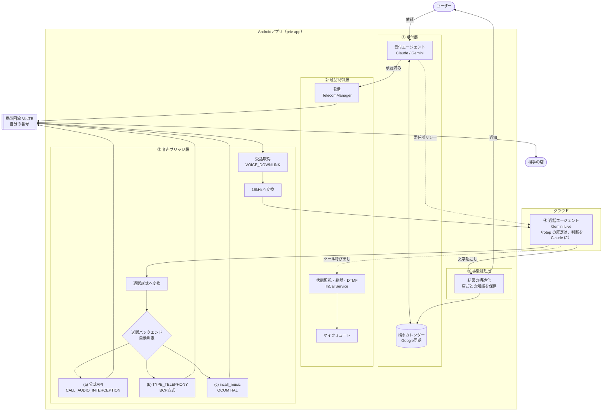

# incall-agent 設計書（概要版）

2026-11-05 作成（Docs「incall-agent 設計書（概要版）」から書き出し）

> 注意：この版の作成後に決定が更新されています。最新の決定は [decisions.md](decisions.md) を参照してください（Gemini接続方式、受話のサンプリングレート、ライセンス、モジュール名 agent-intake → agent-think など）。
>
> API キーは、使う人がそれぞれ自分のスマホに置きます。一時トークンの発行サーバーは作りません（ADR-048）。
>
> 2026-11-10 からは、rotep のアプリの通話は、声を Gemini、次に言うことの判断を Claude に分ける形（二重モデル）が既定です（ADR-053。どこまで確かめたかは [README](../README.md#status)）。設定で切ると、この文書の形（Gemini Live だけ）になります。
>
> 2026-11-07 からは、端末を root にしない形に変わりました（ADR-027）。priv-app として入れる代わりに、adb で shell の権限で起動する「手伝い役」が通話の音を扱います（PC の adb から起動します。スマホだけで起動する形は ADR-041 で足しました）。いまの rotep のアプリ（アイてる!?）の形は、[../README.md](../README.md) と [../apps/rotep/README.md](../apps/rotep/README.md) を見てください。その後に決めたことは [decisions.md](decisions.md) の ADR-027 以降にあります。

## 概要

incall-agent (名称仮)は、自分のスマホと自分の電話番号のまま、予約の電話をAIに任せられるAndroidアプリです。チャットで「土曜19時に〇〇を2名で」と頼むと、AIが自分の携帯回線で店に電話し、予約を取り、結果をカレンダーに入れます。

利用イメージは次のとおりです。

1. チャットで予約を依頼する
2. AIが足りない情報（席の希望など）を聞き、カレンダーの空きから代替候補を用意する
3. AIに任せる範囲（委任ポリシー）を確認して承認する
4. 手元のスマホから自分の番号で発信され、AIが名乗ったうえで店と会話する
5. 結果が通知され、確定した予約はカレンダーに登録される

この文書は方向性を共有するための概要版です。実装の細部は、担当する人がそれぞれ決めてください。

## 背景と目的

目的は、電話でしか予約できない店や病院の予約を、チャットで頼むだけで完了させることです。個人経営の飲食店、美容院、病院などでは、今も電話予約しかできない所が多く残っています。電話は営業時間中にその場で話す必要があり、この「同期的な手間」をなくすのがこのアプリの価値です。

自分の番号から発信することにこだわる理由は2つあります。

- 店からの折り返しや確認の電話が、自分につながるようにするため
- 相手にとって知らない番号からの電話にならず、受けてもらいやすくするため

## 前提と制約

利用者は自分だけで、対象はAndroid、アプリはシステム権限を持つpriv-appとして配置します。ストア配布は想定しません。

| 前提 | 理由 |
| --- | --- |
| 通話サービス（Twilioなど）は使わない | 日本国内の通話では、認証した発信者番号を表示できないため、自分の番号から発信したことにならない |
| priv-appとして配置する（Magisk またはカスタムROM） | 通話音声の取得（`CAPTURE_AUDIO_OUTPUT`）は特権アプリにしか許可されない |
| 外部機器を使わない | 通話経路をスマホのアプリだけで完結させたい |
| 日本のキャリアでVoLTE通話する | 3G停波済みのため、VoLTEで通話できる端末が前提になる |

送話側へ音声を流せるかは、端末のオーディオHALが通話の送話経路を公開しているかで決まります。端末によってできる・できないが分かれる点は、設計で吸収します（音声ブリッジ層を参照）。

## 全体構成

通話音声は自分の携帯回線とアプリの間だけを通り、会話の中身はクラウドのGemini Liveが担います（rotep のアプリの既定では、聞き取りと声を Gemini、次に言うことの判断を Claude が担います。ADR-053）。アプリはpriv-appとして配置し、外部の通話サービスは使いません。



実線は音声とデータの流れ、点線は通話エージェントからのツール呼び出しです。色付きの音声ブリッジ層が、端末によって可否が分かれる部分です。

## 各層の役割

エージェントは2つに分けます。通話の前後で判断する受付エージェントと、通話中に話す通話エージェントです。通話中は応答の速さ、前後は判断の質が求められ、必要な性能が違うためです。

| 層 | 役割 | 方向性（細部は各自で決める） |
| --- | --- | --- |
| ① 受付層 | 不足情報の聞き取り、カレンダー照合、委任ポリシーの生成と承認 | テキストLLM（Claude / Gemini）。カレンダーは端末のカレンダー経由でGoogleと同期 |
| ② 通話制御層 | 発信、状態監視、終話、プッシュ音、通話中のマイク停止 | `TelecomManager` と `InCallService` |
| ③ 音声ブリッジ層 | 受話の取得、送話への注入、形式の変換、遅延・音量・無音の検出 | 受話は `VOICE_DOWNLINK` を基本に、送話は3方式を差し替えられるようにする |
| ④ 通話エージェント層 | 委任ポリシーの範囲で店と会話し、ツールで操作する | Gemini Live（WebSocket）。rotep のアプリの既定は、聞き取りと声を Gemini（WebSocket 2 本）、次に言う文とツールの判断を Claude Sonnet 5.5（HTTP）に分ける形（ADR-053） |
| ⑤ 事後処理層 | 文字起こしの構造化、カレンダー登録、店ごとの知識の保存 | ①の受付エージェントが担当する |
| API キー | 使う人がそれぞれ自分のキーをスマホの設定に貼る。通話はスマホから Gemini Live へ直接つなぐ（rotep のアプリの既定では Claude にも直接つなぐ） | APIキーをアプリに埋め込まないため。一時トークンの発行サーバーは作らない（ADR-048） |

### 音声ブリッジ層の考え方

ここが一番の不確定要素で、端末ごとに使える方式が違います。そのため、送話は次の3方式を共通の窓口の後ろに置き、起動時に上から順に試して使えるものを選びます。

1. 公式の通話音声API（`CALL_AUDIO_INTERCEPTION`、Android 12以降で対応端末のみ）
2. `AudioTrack` から `TYPE_TELEPHONY` 出力へ流す方式（BCPが実証）
3. QualcommのHAL経路 `incall_music`（root と tinymix が必要）

受話を相手の声だけ（`VOICE_DOWNLINK`）にするのは、AIが自分の声を相手の発言として聞かないようにするためです。`VOICE_CALL` しか取れない端末では、エコー対策が別途必要になります。

## 通話1件の流れ

音声ブリッジとGemini Liveは、相手が応答してから動かします。呼び出し音や留守番電話の音声をモデルに聞かせないためで、課金時間も短くなります。

1. 受付：委任ポリシーをユーザーが承認する
2. 通話制御：自分の番号で発信する。呼び出し中は音声ブリッジを止めておく
3. 相手が応答する（通話状態がACTIVEになる）
   1. マイクを止め、送話バックエンドを起動し、受話の取得を始める
   2. Gemini Liveのセッションを開始し、委任ポリシーを渡す（rotep のアプリの既定では、委任ポリシーは Claude に渡し、Gemini には聞き取りと読み上げの 2 本をつなぐ）
4. 通話エージェント：AIであることを名乗り、範囲内で交渉する
   - 予約できた：結果を報告して終話
   - 範囲内の代替で確保できた：結果を報告して終話
   - 範囲外・判断できない：「確認して折り返します」と伝え、要確認として報告して終話
5. 終話：最後の発話の再生が終わるのを待ってから切り、ブリッジを止めてマイクを戻す
6. 事後処理：結果を構造化し、カレンダーに登録し、ユーザーに通知する

## 設計方針として守ること

細部は各自で決めてよいですが、次の方針はどの実装でも守ります。

- **冒頭でAIであることを名乗る**：自分の番号から発信するため、相手は本人からの電話だと思いやすい。名乗りには人名を使わず「AIによる代理のお電話です」と伝える
- **委任範囲外のことはその場で決めない**：範囲外は必ず「確認して折り返します」で終える。誤った予約を防ぐため
- **答えない情報を決めておく**：カード番号や住所など、聞かれても答えない項目を委任ポリシーに含める
- **聞き取りの誤りを前提にする**：日時・人数・電話番号は復唱して確認する
- **通話データは有料枠で扱う**：Gemini APIの無料枠では、送ったデータが製品改善に使われるため
- **差し替えを前提にする**：音声モデルや送話方式は変わる前提で、上位の層から隠す

## 各自で決めること

次の項目はこの文書では決めず、担当する層の実装者が決めます。迷ったときの目安だけ添えています。

| 項目 | 担当 | 目安 |
| --- | --- | --- |
| 予約の種類ごとの必須項目（スキーマ） | ① 受付層 | 飲食・美容院・病院から始める |
| 委任ポリシーのデータ形式 | ① 受付層・④ 通話エージェント層 | 人が読んで承認できる形にする |
| 受付エージェントに使うモデル | ① 受付層 | Claude か Gemini のテキストモデル |
| 依頼の入口（チャット画面） | ① 受付層 | 最初は簡素なアプリ内チャットでよい |
| `VOICE_CALL` しか取れない場合のエコー対策 | ③ 音声ブリッジ層 | 発話中は入力を止める方式と、エコー除去の両方を試して比べる |
| 送話バックエンドの判定順と切り替え条件 | ③ 音声ブリッジ層 | 公式API → TYPE\_TELEPHONY → incall\_music |
| 通話エージェントのツールの細かい定義 | ④ 通話エージェント層 | 空き確認・代替案判定・結果報告・終話・プッシュ音の5つが軸 |
| Gemini Liveのモデルと声の設定 | ④ 通話エージェント層 | 通常版で日本語の品質を確かめてから考える |
| 店ごとの知識の保存形式 | ⑤ 事後処理層 | 次の通話前にプロンプトへ入れられる形にする |
| 折り返しの着信に対応するか | 全体 | 最初は発信のみ。着信は本人が受ける |
| 通話中に本人へ確認する機能 | 全体 | 最初は入れず「折り返します」で済ませる |

## 進め方

技術的に一番不確かな音声経路から先に確かめ、各段階を通過してから次に進みます。段階1〜4は既存のアプリ（BCR、BCP）とadbだけで確認でき、コードを書く前にその端末で方式が通るかが分かります。

1. VoLTE通話の確認：SIMで普通に発信・着信できる
2. 権限と音声ポリシーの確認：通話用出力や `incall_music` の有無が分かる
3. 受話の取得（BCR）：相手の声だけが録れる
4. 送話の注入（BCP）：既知の音声ファイルが相手に聞こえる
5. 折り返し試験：受話をそのまま送話に返し、片道の遅延を測る
6. Gemini Liveに接続：自分宛ての通話で、名乗り・割り込み・プッシュ音が動く
7. 受付・事後処理を作り込み、了承済みの店で試す：予約1件が完了し、カレンダーに入る

最初の完成は7の状態とします。

端末は、PoC用にPixelか国内で売られているQualcomm機を主に使います。BCPによる送話の実績があり、技適の問題もないためです。BlackBerry KEY2 LEは並行候補として扱い、まず段階1（通話ができるか）だけを確かめます。

## リポジトリ構成

リポジトリ名は `incall-agent` とし、1つのリポジトリの中をモジュールで分けます。用途（予約）やモデル名（Gemini）を名前に入れないのは、仕組みが予約以外の電話にも使え、部品は差し替える前提だからです。

```
incall-agent/
├── app/              # Androidアプリ本体（priv-app）
├── telecom/          # ② 通話制御
├── audio-bridge/     # ③ 音声ブリッジ（送話バックエンド3方式を含む）
├── agent-live/       # ④ 通話エージェント（Gemini Liveクライアント、ツール定義）
├── agent-intake/     # ① 受付・⑤ 事後処理
├── magisk-module/    # priv-app配置と権限の許可リスト
└── poc/              # 段階1〜5の検証用スクリプトとアプリ
```

- `audio-bridge` は他のモジュールに依存させず、将来は別リポジトリに切り出せるようにする
- モデル名に依存する処理は `agent-live` の中に閉じ込める
