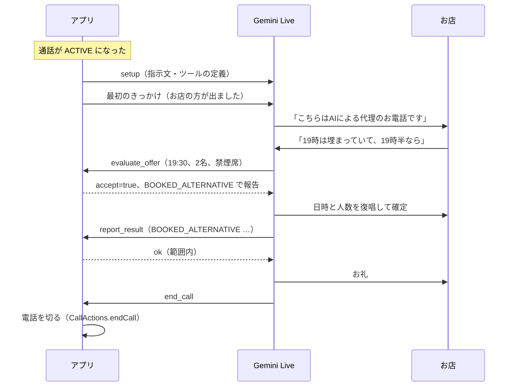

# 話すエージェント（Gemini Live）への渡し方

承認された委任ポリシー（[delegation-policy.md](delegation-policy.md)）を、話すエージェント（Gemini Live）が使える形に変える部分です。共通の土台 `agent-live` に置いています。

| 置き場所（`agent-live/src/main/kotlin/io/github/incallagent/agent/live/`） | 内容 |
| --- | --- |
| `LiveInstructions.kt` | 委任ポリシーから、Gemini Live への指示文（システム指示）を作る |
| `LiveTools.kt` | ツール（関数）の定義 |
| `OfferEvaluator.kt` | お店の提案を受けてよいかを、**コードで**判断する |
| `ToolCallHandler.kt` | AI のツール呼び出しを実行し、答えを返す |
| `LiveMessages.kt` | WebSocket で送受信する JSON（接続時の設定、最初のきっかけ、音声、ツールの答え） |
| `ServerEvents.kt` | サーバーからのメッセージを、音声・割り込み・文字起こし・ツール呼び出しなどの出来事に分ける |
| `LiveSession.kt` | 1回の会話の流れ（設定 → 準備完了 → きっかけ → 音声のやり取り、ツール呼び出しへの自動の返事） |
| `LiveEndpoint.kt` / `OkHttpLive.kt` | 接続先の URL と、OkHttp での WebSocket 接続。エラーの文から API キーを消す |

> [!NOTE]
> WebSocket での接続と音声のやり取りまでできています。通話の代わりにスマホのマイクとスピーカーを使う「AI会話テスト」で試しました。API キーは、使う人がそれぞれ自分のスマホに置きます（一時トークンの発行サーバーは作りません。ADR-048）。通話音声への接続はまだです。rotep のアプリ（アイてる!?）は、通話の流れと音声の通り道をアプリの中に先に作って使っています（5 節）。

---

## 1. 考え方：判断は AI ではなくコードがする

話すエージェントは聞き間違えることがありますし、その場の流れで約束しすぎることもあります。そこで、**受けてよいかどうかの判断は AI に任せず、アプリのコードがします**。

- AI は、お店から日時・人数・金額・条件の提案を受けたら、返事をする前に必ず `evaluate_offer` を呼びます
- アプリ（`OfferEvaluator`）が委任ポリシーと照らし合わせて「受けてよい / 受けない」と理由を返し、AI はそれに従います
- 結果の報告（`report_result`）も、アプリが `OutcomeCheck` で確かめ、範囲外なら AI に直させます
- 結果を報告するまでは、電話を切らせません（`end_call` を断る）。ふつうに終わった通話には、結果が残ります。電話の途中でアプリが終わったときは、結果が残らないことがあります（次に開いたときに、結果が分からないことを知らせます）



---

## 2. ツール

| ツール | いつ呼ぶか | アプリがすること |
| --- | --- | --- |
| `evaluate_offer` | お店から提案があり、受ける返事をする前 | 日時・人数・金額・キャンセル料・前払い・キャンセル待ち・必須の条件を、委任ポリシーと照らし合わせる。`accept`、`isFirstChoice`、`reasons`、次にすべきこと（`instruction`）を返す |
| `report_result` | 用件が済んだとき、または折り返しにしたとき | `CallOutcome` を作って記録し、`OutcomeCheck` で確かめる。問題があれば `ok: false` と理由を返す |
| `end_call` | 報告してお礼を言った後 | 報告済みなら電話を切る（`CallActions.endCall`）。未報告なら断る |
| `send_dtmf` | 自動音声の案内でボタン操作を求められたとき | 0〜9、*、# だけを受け付けて、プッシュ音を送る（`CallActions.sendDtmf`） |

設計書の5つの軸（空き確認・代替案判定・結果報告・終話・プッシュ音）のうち、「空き確認」と「代替案判定」は `evaluate_offer` 1つにまとめました。どちらも「お店の言った内容が範囲内か」の判断だからです。

電話を切る・プッシュ音を送るといった実際の通話の操作は、`CallActions` というインターフェースで受け取ります。各自のアプリが、通話制御（`telecom`）を使って実装します。

---

## 3. 指示文の例

[examples/delegation-policy.example.json](examples/delegation-policy.example.json) を `LiveInstructions.render()` に通すと、次の文章になります（今日を 2026年11月7日 とした場合）。決まりの部分（「必ず守ること」）は固定で、それ以外は委任ポリシーから作ります。

```
あなたは、ユーザーの代わりにお店へ電話をかけている AI です。電話の相手は「ビストロ・サンプル」の方です。
今日は 2026年11月7日(土) です。

# 必ず守ること
1. 相手が出たら、最初に「お忙しいところ失礼いたします。こちらはAIによる代理のお電話です。」と言い、AI であることを伝える。人の名前で名乗らない。
2. 決めてよいのは、下の「任されていること」の範囲だけ。それ以外のことを聞かれたり提案されたりしたら、自分で決めずに「その点は確認して、改めてこちらから折り返しご連絡いたします。」と伝え、report_result（status は NEEDS_USER_DECISION、pendingItems に決められなかったこと）を呼んでから end_call で終える。
3. お店から日時・人数・金額・条件の提案があったら、受ける返事をする前に必ず evaluate_offer を呼び、その答えに従う。accept が false なら受けない。
4. 日時・人数・電話番号は、相手に復唱して確かめる。
5. 次の情報は、聞かれても伝えない：クレジットカード番号、銀行口座、暗証番号・パスワード、住所、生年月日、マイナンバー・保険証などの番号、病状や健康に関する詳細。支払いに関わる情報は扱わない。
6. 用件が済んだら、report_result で結果を報告し、お礼を言ってから end_call を呼ぶ。
7. 自動音声の案内でボタンの操作を求められたら send_dtmf を使う。留守番電話につながったら、何も残さずに status を NOT_REACHED として報告して終える。
8. 丁寧な敬語で、短くはっきり話す。相手の話をさえぎらない。聞き取れなかったときは聞き返す。
9. 通話は 5 分以内に終える。

# 用件
新しく予約をお願いする。

# 希望
- 人数：2名
- 日時（上から順にお願いする）：
  1. 2026年11月14日(土) 19:00 から
  2. 2026年11月14日(土) 18:30〜20:00 の間に始まる時間
  3. 2026年11月15日(日) 18:00〜19:30 の間に始まる時間
- 時間：120分
- 禁煙席：必須（これがないなら受けない）
- 個室：できれば
- お店に伝えること：誕生日のお祝いです

# 任されていること
- 人数は 2〜3名なら受けてよい
- 日時は上の候補の範囲なら受けてよい（範囲外は受けない）
- 金額：1人 8000円まで
- キャンセル料などの条件への同意：しない
- 前払い・予約金への同意：しない
- キャンセル待ちへの登録：しない
- 判断に迷ったら、受けずに折り返す

# 聞かれたら伝えてよい情報
- 予約名：ヤマダ（名乗りには使わない）
- 連絡先の電話番号：090-0000-0000
```

この文章には予約名と電話番号が入ります。AI がお店に答えるために必要だからです。そのため、**Gemini API の有料枠にだけ送り、ログには出さないでください**（無料枠では、送ったデータが製品の改善に使われるため。design.md）。rotep のアプリの既定の二重モデル（ADR-053）では、この文章は Gemini には送らず、次に言うことを決める Claude に送ります。Gemini には、聞き取る相手の声と、読み上げる文だけを渡します。

承認されていない委任ポリシーを渡すと、`LiveInstructions.render()` はエラーにします。

---

## 4. WebSocket で送受信する内容（`LiveMessages`）

| 関数 | いつ | 内容 |
| --- | --- | --- |
| `setup(policy, today)` | 接続した直後に1回 | モデル（既定 `gemini-3.8-live`、ADR-005）、音声で返す設定、言語、指示文、ツールの定義、両方向の文字起こしを有効にする設定 |
| `openingCue()` | 通話が ACTIVE になったとき | 「お店の方が出ました。最初のあいさつから始めてください」というきっかけ。AI が最初に名乗るようにするため |
| `answerToolCalls(message, handler)` | サーバーからツール呼び出しが来たとき | 呼び出しを `ToolCallHandler` で実行し、`id` を合わせた答えを作る |

### 公式の文書で確かめたこと（2026-11-06）

- `gemini-3.8-live` は関数呼び出しに対応している（答えを待つ形・待たない形の両方）
- 接続時の設定（`BidiGenerateContentSetup`）の項目名：`model`（`models/…` の形）、`generationConfig`、`systemInstruction`、`tools`、`inputAudioTranscription`、`outputAudioTranscription` など
- ツールの答えは、呼び出しの `id` で対応づける
- Live API では、ツールの答えを自動で返す仕組みはない（アプリが返す）
- 接続が切られる前に `GoAway`（残り時間 `timeLeft`）が届く

- 接続先：`wss://generativelanguage.googleapis.com/ws/google.ai.generativelanguage.v1beta.GenerativeService.BidiGenerateContent?key=…`（API の仕様では、一時トークンは `BidiGenerateContentConstrained?access_token=…` です。このアプリでは使いません。ADR-048）
- 最初のメッセージの外側は `setup`。音声は `realtimeInput.audio`（base64、`audio/pcm;rate=16000`、16bit リトルエンディアン）。ツール呼び出しは `toolCall.functionCalls`
- サーバーからの音声は `serverContent.modelTurn.parts[].inlineData`。割り込みは `interrupted`、ターンの終わりは `turnComplete`、文字起こしは `inputTranscription` / `outputTranscription`

### まだ確かめていないこと（AI会話テストで確かめる）

2026-11-07 の AI会話テストで、接続、名乗り、ツール、結果の報告までは通りました。下の一覧は、そのあと見直していません。

- `clientContent`（最初のきっかけ）と `toolResponse` の外側の名前。公式の WebSocket の手引きには例がなかった
- `responseModalities` と `speechConfig` を `generationConfig` の中に置く形で通るか（参照ページでは確かめられなかった）
- `inputTranscription` は順番が保証されないと参照ページにある。画面の「店員」の行は、届いた順につないでいるだけ
- 関数の引数の型の書き方（`OBJECT`、`STRING` など大文字の形）がそのまま通るか
- `speechConfig.languageCode` に `ja-JP` を指定できるか
- 指示文の長さが、応答の速さに影響するか

---

## 5. まだ作っていないもの（次の作業）

| もの | 内容 | 必要なもの |
| --- | --- | --- |
| 通話音声への接続 | マイクの代わりに受話（`DownlinkRecorder`、48kHz → 16kHz に変換）を送り、スピーカーの代わりに送話へ注入する（`UplinkToneInjector` の方式） | PoC の結果（ADR-004） |
| 時間切れの処理 | `maxCallSeconds` を過ぎたら、折り返しの言葉で終える | ― |
| 接続断の処理 | `GoAway` やエラーのとき、録音済みの音声で「改めておかけ直しします」と伝えて切る | ― |

rotep のアプリ（アイてる!?、`apps/rotep`）では、このうち次のものをアプリの中で先に作りました。共通の土台に移すのは、このあとです。

- 通話音声への接続：`call/CallAudioPath`。練習（L0）はスマホのマイクとスピーカー（`LocalAudioPath`）、電話をかける形（L2・L3）は手伝い役（`ShellAudioPath`）。手伝い役の形は、2026-11-09 の協力者との通話で、AI の声が相手に届いて結果の報告まで通りました（direct の方式）
- 時間切れと接続断：`call/CallSession` が AI を止めて、音で本人に知らせる。時間を指定した電話では本人がいないので、時間切れのときは AI に折り返しの文を伝えさせてから切る（ADR-040）。録音済みの音声で相手に伝える部分は、まだです
